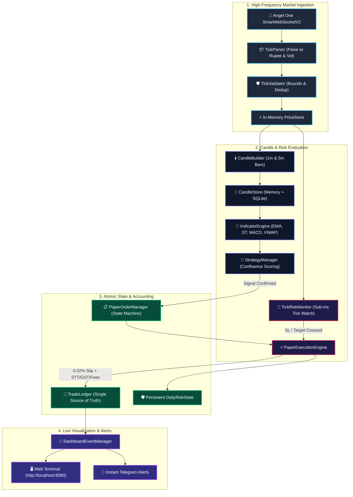

<div align="center">

# ⚡ DAY TRADER PRO V2
### **Event-Driven Algorithmic Trading & Quantitative Execution Engine**
*High-Frequency WebSocket Streaming • Multi-Timeframe Candle Builder • Confluence Strategy Engine • Sub-Millisecond Tick-Level Risk Monitor*

---

[](https://www.python.org/)
[](https://www.nseindia.com/)
[](file:///tests/)
[](file:///trader/execution/paper_engine.py)
[](https://smartapi.angelone.in/)
[](file:///LICENSE)

<br/>

**[Architecture](#-system-architecture)** •
**[Key Capabilities](#-key-capabilities)** •
**[Strategies](#-trading-strategies)** •
**[Risk Controls](#-tick-level-risk--regulatory-costs)** •
**[Historical Data](#-historical-backtesting-data)** •
**[Quick Start](#-quick-start--installation)** •
**[Dashboard UI](#-real-time-web-dashboard)**

---

</div>

<br/>

## 🌟 Overview

**Day Trader Pro V2** is a modular, event-driven quantitative trading platform engineered specifically for **Indian Equities (NSE)**. 

Unlike legacy bots that suffer from REST polling rate limits (`429 Too Many Requests`), V2 streams raw binary ticks via **Angel One SmartAPI WebSocket (`SmartWebSocketV2`)**, aggregates multi-timeframe candles in-memory, monitors protective stop-losses on every tick in sub-milliseconds, and executes atomic paper orders with exact Indian regulatory transaction costs (STT, GST, NSE turnover fees, and stamp duty).

> [!IMPORTANT]
> **Safety Guarantee**: The system permanently operates under `PAPER_TRADING=true`. All real-money order routing is strictly blocked by `PaperTradingIsolationError` to protect capital.

---

## 🏛️ System Architecture



---

## 🚀 Key Capabilities

<table>
<tr>
<td width="50%">

### ⚡ SmartAPI WebSocket Streaming
* **Zero Rate Limits**: Replaces REST HTTP polling loops with continuous binary tick streaming.
* **Auto-Reconnection**: Reconnects with exponential backoff and auto-restores subscribed NSE tokens.
* **Integrity Guard**: Drops out-of-order sequence numbers, validates LTP bounds, and flags feed staleness.

</td>
<td width="50%">

### 🚨 Sub-Millisecond Tick Risk Monitor
* **Tick-Level Protection**: Evaluates stop-loss and profit targets on **every incoming tick** without waiting for candle close.
* **Conservative Collision Logic**: In violent gaps, prioritizes protective stop-loss over optimistic targets.
* **Deduplicated Triggers**: Guaranteed single exit event per position.

</td>
</tr>
<tr>
<td width="50%">

### 🕯️ Multi-Timeframe Candle Builder
* **Independent Timeframes**: Builds clean **1-minute** and **5-minute** completed OHLCV candles.
* **Exchange Clock Aligned**: Exact synchronization with Asia/Kolkata session timing (09:15 to 15:30).
* **Cumulative Volume Tracking**: Accurately computes traded volume deltas without double-counting.

</td>
<td width="50%">

### ⚖️ Regulatory Cost Accounting
* **Exact Indian Tariffs**: Computes brokerage (₹20/leg), STT (0.025% on sell), NSE charges (0.00345%), GST (18%), and Stamp Duty (0.003%).
* **Realistic Slippage**: Models execution drag with conservative 0.02% base slippage.
* **Net vs Gross**: Eliminates false illusions by evaluating profitability only after net deductions.

</td>
</tr>
</table>

---

## 🎯 Trading Strategies

The strategy engine (`trader/strategies/`) executes modular, testable setups on strictly completed candles:

| Strategy | Primary Indicators | Long Entry Condition | Protective Stop / Target |
| :--- | :--- | :--- | :--- |
| **EMA_CHANNEL** | EMA 5, EMA 9, EMA 33 | EMA 5 > EMA 9 > EMA 33 with pullback bounce off channel | Structural swing low / 1.5R Target |
| **TREND_MOMENTUM** | Supertrend (10, 3.0), EMA 9 | Supertrend = +1 (Green) and close above EMA 9 | Supertrend trailing band / 1.5R Target |
| **VWAP_PULLBACK** | Session VWAP, Prior Bar Low | Price dips below session VWAP and reclaims above with volume | Reclaim candle low / 1.5R Target |
| **CONFLUENCE** *(Default)* | Multi-Strategy Aggregator | Score $\ge 65\text{ pts}$ with **strict directional agreement** | Structural support / minimum 1.5R Target |

> [!NOTE]
> **Direction Agreement**: If one sub-strategy produces a BUY signal while another produces a SELL signal on the same bar, `ConfluenceStrategy` automatically discards both to prevent conflicting trades.

---

## 🛡️ Tick-Level Risk & Regulatory Costs

V2 introduces persistent risk tracking that **survives process restarts**:

```json
{
  "capital": 1000000.0,
  "risk_per_trade_pct": 1.0,
  "max_position_allocation_pct": 35.0,
  "max_daily_loss_inr": 2000.0,
  "max_trades_per_day": 10,
  "cooldown_minutes": 15,
  "flat_by": "15:20"
}
```

* **Kill Switch**: If cumulative realized daily loss reaches the configured limit, all further order admission is locked.
* **Symbol Cooldown**: After an exit, a 15-minute cooldown prevents immediate re-entries and whipsaws.
* **Session Square-Off**: Mandatorily closes all open paper positions before `15:20 IST` using real market quotes.

---

## 📊 Historical Backtesting Data

The repository includes curated genuine market data across multiple resolutions:

| Timeframe | History Length | Date Range | Total Records | Instruments Included |
| :---: | :---: | :---: | :---: | :--- |
| **1-Day (Daily)** | **248 Trading Days (~1 Year)** | Oct 2025 – Oct 2026 | ~248 bars/stock | HDFCBANK, INFY, RELIANCE, TCS, ICICIBANK, SBIN, **NIFTY 50** |
| **5-Minute (5m)** | **~60 Trading Days (~3 Months)** | Jul 2026 – Oct 2026 | ~4,379 bars/stock | HDFCBANK, INFY, RELIANCE, TCS, ICICIBANK, SBIN, **NIFTY 50** |
| **1-Minute (1m)** | **7–10 Trading Days** | Mid-Oct 2026 – Present | 17,614 bars | Watchlist stocks with all 29 precomputed quant indicators |
| **Live Database** | **Continuous** | Live Sessions | ~2,500+ bars | Active SQLite tick archive (`ticks_market_data.db`) |
| **Long-Term** | **10 Full Years (2,500+ Days)** | 2016 – 2026 | 500,000+ bars | Multi-year 1m archive in `historical_data/` |

---

## 🧪 Comprehensive Automated Test Suite

V2 maintains an exhaustive automated test suite covering every core engine:

```bash
python -m unittest discover tests
```

```text
...................................................................................
Ran 417 tests in 16.126s

OK (100% Passing, 0 Errors, 0 Failures)
```

<details>
<summary><b>🔍 View Dedicated V2 Test Modules</b></summary>

| Test File | Component Tested | Coverage |
| :--- | :--- | :---: |
| [`tests/test_tick_processing.py`](file:///d:/Trade-agent/day-trader-skill/tests/test_tick_processing.py) | Tick parser, bounds validation, sequence dedup, price store | 5 Tests |
| [`tests/test_candle_builder.py`](file:///d:/Trade-agent/day-trader-skill/tests/test_candle_builder.py) | 1m/5m OHLCV generation, boundary crossing, volume deltas | 2 Tests |
| [`tests/test_websocket.py`](file:///d:/Trade-agent/day-trader-skill/tests/test_websocket.py) | Authentication, subscriptions, reconnects, feed staleness | 4 Tests |
| [`tests/test_indicators.py`](file:///d:/Trade-agent/day-trader-skill/tests/test_indicators.py) | EMA, Supertrend, MACD, VWAP, RSI, HH/LL 33 accuracy | 6 Tests |
| [`tests/test_strategies.py`](file:///d:/Trade-agent/day-trader-skill/tests/test_strategies.py) | Strategy triggers, direction agreement, duplicate suppression | 3 Tests |
| [`tests/test_risk_engine_v2.py`](file:///d:/Trade-agent/day-trader-skill/tests/test_risk_engine_v2.py) | Tick SL/Target triggers, gap handling, risk persistence | 4 Tests |
| [`tests/test_paper_execution.py`](file:///d:/Trade-agent/day-trader-skill/tests/test_paper_execution.py) | Order state machine, 0.02% slippage, cost model fees | 3 Tests |
| [`tests/test_backtesting.py`](file:///d:/Trade-agent/day-trader-skill/tests/test_backtesting.py) | Chronological train/val/test splits, collision metrics | 3 Tests |

</details>

---

## ⚡ Quick Start & Installation

### 1. Clone the Repository
```bash
git clone https://github.com/Gautam0324/trade.git
cd trade
```

### 2. Configure Environment Credentials
Credentials are automatically read from environment variables or `trader/secrets.json`:
```bash
# Optional: Set via environment
export ANGEL_API_KEY="your_smartapi_key"
export ANGEL_CLIENT_CODE="your_client_code"
export ANGEL_PASSWORD="your_pin"
export ANGEL_TOTP_SECRET="your_totp_secret"
export PAPER_TRADING=true
export LIVE_TRADING=false
```

### 3. Launch Master Supervisor (Bot + Dashboard)
```bash
python run.py
```
* Launches the **Web Dashboard** on `http://localhost:8080`
* Connects the **Live Trader Engine** to SmartAPI WebSocket
* Output logs stream live to console and `trader/signals_audit.csv`

### 4. Health Check
```bash
curl http://localhost:8080/health
```
```json
{
  "status": "HEALTHY",
  "paper_trading": true,
  "live_trading": false,
  "timestamp": "2026-10-30 12:00:00 IST"
}
```

---

## 🖥️ Real-Time Web Dashboard

Open `http://localhost:8080` in any browser to access the live trading terminal:

* **Header Controls**: Live IST Clock, Session Status, and Streaming Mode Badge.
* **Portfolio Cards**: Total Portfolio Value, Day's Realized P&L, Active Holding Amount, Executed Trades.
* **Live Charts**: Real-time equity curve and intraday performance visualization.
* **Position Manager**: Active positions table with entry price, live LTP, trailing SL, target, and net unrealized P&L.
* **Audit Journal**: Searchable table of completed trades with gross P&L, statutory fee breakdown, and exit triggers.

---

## 📄 License & Attribution

* **Maintainer & Lead Developer**: **Gautam** ([@Gautam0324](https://github.com/Gautam0324))
* **License**: Licensed under the [MIT License](file:///d:/Trade-agent/day-trader-skill/LICENSE).
* **Disclaimer**: This system is designed and distributed strictly for quantitative research, backtesting, and paper trading on Indian Equities. Never deploy live trading without rigorous personal financial validation.
