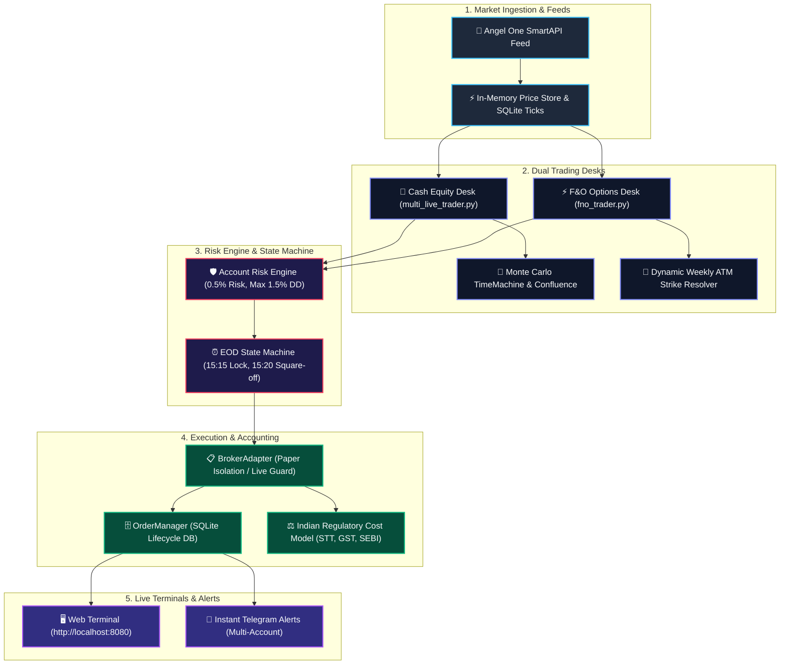

<div align="center">

# ⚡ DAY TRADER PRO V3
### **Event-Driven Multi-Asset Algorithmic Trading & Quantitative Execution Engine**
*High-Frequency WebSocket Streaming • Cash Equities & F&O Options Desk • V3 Trend Pullback & Monte Carlo Odds Engine • Real Regulatory Accounting*

---

[](https://www.python.org/)
[](https://www.nseindia.com/)
[](file:///tests/)
[](file:///trader/broker_adapter.py)
[](https://smartapi.angelone.in/)
[](file:///LICENSE)

<br/>

**[Architecture](#-system-architecture)** •
**[Key Capabilities](#-key-capabilities)** •
**[Trading Desks](#-trading-desks)** •
**[V3 Strategies & Monte Carlo](#-v3-strategy--monte-carlo-odds-engine)** •
**[Risk Controls](#-tick-level-risk--regulatory-costs)** •
**[Quick Start](#-quick-start--installation)** •
**[VPS Deployment Guide](#-vps-247-headless-deployment-guide)** •
**[Dashboard UI](#-real-time-web-dashboard)**

---

</div>

<br/>

## 🌟 Overview

**Day Trader Pro V3** is an institutional-grade, multi-asset quantitative trading platform engineered specifically for **Indian Markets (NSE Equities & NFO Derivatives)**.

The system is 100% standalone and deterministic, requiring **zero runtime AI agents or LLMs** to execute trades. It streams live ticks via **Angel One SmartAPI**, aggregates multi-timeframe completed candles, runs statistical Monte Carlo simulations to predict trade probabilities, and enforces strict risk management with exact Indian regulatory cost models (STT, GST, Exchange turnover, and Stamp Duty).

> [!IMPORTANT]
> **Safety Guarantee**: The platform defaults to `LIVE_TRADING=false` / `TRADING_MODE=paper`. All execution is isolated through `BrokerAdapter` to guarantee zero capital risk during setup and testing.

---

## 🏛️ System Architecture



---

## 🚀 Key Capabilities

<table>
<tr>
<td width="50%">

### 🏢 Cash Equity Scanner
* **Top Liquid Universe**: Actively monitors high-momentum NSE stocks.
* **Multi-Account Broadcast**: Independent ledger and sizing for Gautam, Himanshu, and Prateek.
* **Volume Delta Filtering**: Ensures breakouts have genuine institutional volume support.

</td>
<td width="50%">

### ⚡ NIFTY & BANKNIFTY Options Desk
* **Dynamic ATM Strike Resolver**: Automatically resolves nearest weekly expiry ATM Call & Put contracts.
* **1:3 Risk-to-Reward Ratio**: Disciplined 5% Stop-Loss with 15% Take-Profit targets.
* **Cooldown Gates**: 15-minute post-trade cooldown prevents whipsaw re-entries.

</td>
</tr>
<tr>
<td width="50%">

### 🎲 Monte Carlo Odds Engine
* **10,000 Replays**: Simulates session paths from 60 days of genuine price action.
* **Loss Prediction**: Determines odds of Target vs Stop before risking capital.
* **Regime Classifier**: Rejects low-probability setups in sideways/choppy regimes.

</td>
<td width="50%">

### ⚖️ Indian Regulatory Accounting
* **Authoritative Math**: Exact STT (0.025% cash / 0.125% options), GST (18%), NSE charges, SEBI fees, Stamp Duty.
* **Net Profit Realism**: Evaluates P&L strictly net of all government tariffs and brokerage.
* **Ledger Reconciliation**: Self-healing SQLite and JSON ledgers.

</td>
</tr>
</table>

---

## 🎯 V3 Strategy & Monte Carlo Odds Engine

### 1. V3 Trend Pullback Strategy (Primary Timeframe: 5m, HTF: 15m)
* **Higher Timeframe Filter (15m)**: Close > EMA 50, EMA 9 > EMA 21 > EMA 50, ADX(14) > 20.
* **Primary Entry (5m)**: Price pulls back into the dynamic value zone between EMA 9 and EMA 21, followed by a bullish reversal candle closing above the prior candle's high.
* **Exits**:
  * **TP1 at 1.0R**: Books 50% profits and moves Stop-Loss to Breakeven.
  * **TP2 at 2.0R**: Books remaining 50% position.
  * **Protective Stop**: Set at 1.5x ATR below recent structural swing low.

### 2. Time Machine Odds Engine (`trader-timemachine/timemachine.py`)
Before taking trades, the statistical engine simulates 10,000 potential outcomes:
* 🟢 **"Leans toward Target"**: Win probability > 65% $\rightarrow$ **Signal Approved**.
* 🔴 **"Leans toward Stop"**: Loss probability high $\rightarrow$ **Signal Blocked**.
* 🟡 **"Coin Flip"**: Risk/Reward unfavorable $\rightarrow$ **Signal Discarded**.

---

## 🛡️ Tick-Level Risk & Regulatory Costs

Persistent risk tracking enforces discipline across restarts:

```json
{
  "capital": 1000000.0,
  "risk_per_trade_pct": 0.5,
  "max_position_allocation_pct": 40.0,
  "max_daily_loss_pct": 1.5,
  "max_trades_per_day": 30,
  "cooldown_minutes": 15,
  "flat_by": "15:20"
}
```

* **Kill Switch**: If cumulative realized daily loss reaches 1.5%, all new trade admissions are locked.
* **Symbol Cooldown**: A 15-minute cooldown per instrument prevents whipsaw churn.
* **Session Square-Off**: Mandatorily flattens all open positions at `15:20 IST` using real market quotes.

---

## 🌐 VPS 24/7 Headless Deployment Guide

The bot is **100% self-contained Python** and does not require Antigravity, an IDE, or any LLM to run on a Linux/Windows VPS.

### 1. Requirements on VPS
* Ubuntu 22.04 LTS (or any Linux/Windows server)
* Python 3.10, 3.11, or 3.12
* Node.js & PM2 (recommended for 24/7 process management)

### 2. Clone & Install
```bash
git clone https://github.com/Gautam0324/trade.git
cd trade
pip install -r requirements.txt
```

### 3. Setup Secrets (`.env`)
```bash
nano .env
```
Ensure your credentials are set:
```ini
SMARTAPI_API_KEY=your_key
SMARTAPI_CLIENT_CODE=your_client_code
SMARTAPI_PIN=your_pin
SMARTAPI_TOTP_SECRET=your_totp_secret

TELEGRAM_BOT_TOKEN=your_telegram_bot_token
TELEGRAM_CHAT_ID=your_chat_id

TRADING_MODE=paper
LIVE_TRADING=false
```

### 4. Run 24/7 with PM2 (Auto-Restart on Reboot)
```bash
# Install PM2 globally
npm install -g pm2

# Start master supervisor under PM2
pm2 start run.py --name "trade-bot" --interpreter python3

# Save PM2 state so it restarts on VPS reboot
pm2 save
pm2 startup
```

* **Live Logs**: `pm2 logs trade-bot`
* **Restart**: `pm2 restart trade-bot`
* **Stop**: `pm2 stop trade-bot`
* **Web Dashboard**: Access live via `http://<YOUR_VPS_IP>:8080`

---

## ⚡ Quick Start & Local Execution

To start all services locally (Dashboard, Cash Engine, F&O Desk, Telegram Listener):

```powershell
python run.py
```

Or run individual desks independently:
```powershell
# Run Cash Equity Scanner
python trader/multi_live_trader.py

# Run F&O Options Desk
python trader/fno_trader.py
```

---

## 🖥️ Real-Time Web Dashboard

Open `http://localhost:8080` in any browser to access the live trading terminal:

* **Header Controls**: Live IST Clock, Session Status, and Streaming Mode Badge.
* **Portfolio Cards**: Total Portfolio Value, Day's Realized P&L, Active Holding Amount, Executed Trades.
* **Live Charts**: Real-time equity curve and intraday performance visualization.
* **Position Manager**: Active positions table with entry price, live LTP, trailing SL, target, and net unrealized P&L.
* **Audit Journal**: Searchable table of completed trades with gross P&L, statutory fee breakdown, and exit triggers.

---

## 📄 License & Attribution

* **Maintainer & Lead Developer**: **Gautam** ([@Gautam0324](https://github.com/Gautam0324))
* **Original Template**: Jake Schincariol
* **License**: Licensed under the [MIT License](file:///d:/Trade-agent/day-trader-skill/LICENSE).
* **Disclaimer**: Designed and distributed strictly for quantitative research and paper trading. Never risk live capital without personal financial validation.
