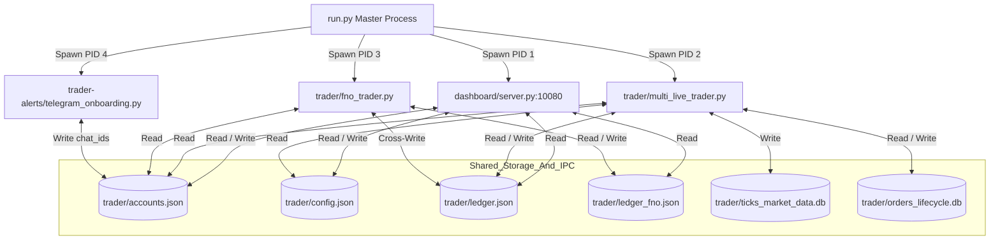
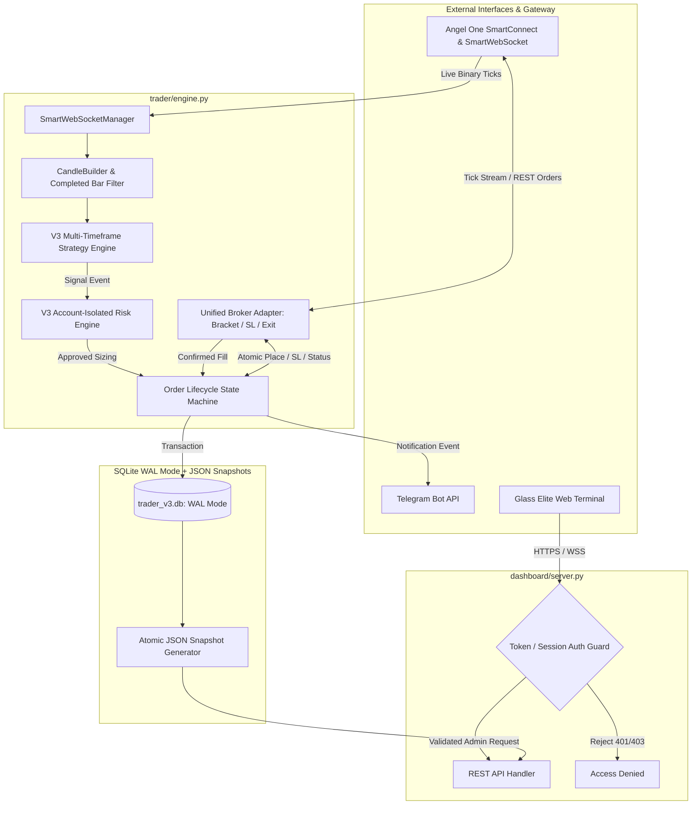
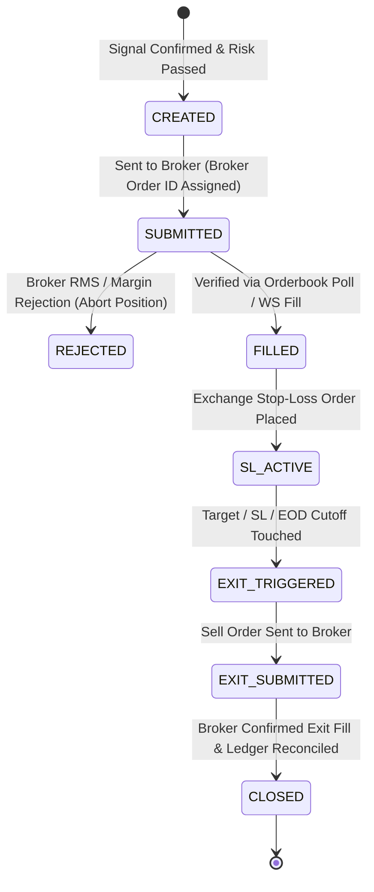

# PHASE 1 -- SYSTEM ARCHITECTURE DOCUMENT
## Day Trader Pro -- Current Architecture vs. Corrected Target Architecture
**Date:** 2026-11-12 | **Assessment Mode:** Architectural Blueprint | **Version:** 2.0.0-PRO  
**Repository:** `https://github.com/Gautam0324/trade`  
**Author:** Principal Software Architect & Quantitative Systems Engineer  

---

## 1. Existing System Architecture

### 1.1 Process Topology & Inter-Process Communication (IPC)
The current Day Trader Pro platform operates as a multi-process Python application orchestrated by `run.py`. Each subsystem runs in an isolated OS process:

### 1.2 Data Storage & Persistence Schema

1. **Flat File JSON Stores:**
   - `trader/accounts.json`: Multi-account credentials, active watchlists, assigned capitals, and linked Telegram chat IDs.
   - `trader/config.json`: Global operational parameters (budget, risk limits, session cutoff `flat_by`, strategy thresholds).
   - `trader/ledger.json`: Primary account (Gautam) capital, open positions, daily realized P&L, and trade history.
   - `trader/ledger_himanshu.json`, `trader/ledger_prateek.json`: Secondary multi-tenant equity ledgers.
   - `trader/ledger_fno.json`: Dedicated F&O Derivatives account ledger.
   - `trader/daily_risk_state.json`: Intraday order counters and trade loss tracking.

2. **SQLite Relational Databases:**
   - `trader/ticks_market_data.db`: Stores raw completed 1m candles (`ticks` and `market_candles` tables) with unique compound indexes `(symbol, timestamp)` for idempotent back-fill and tick ingestion.
   - `trader/orders_lifecycle.db`: Managed by `trader/order_manager.py` to record the 13-step order transition history (`CREATED` $\to$ `SUBMITTED` $\to$ `FILLED` $\to$ `SL_PENDING` $\to$ `EXIT_PENDING` $\to$ `CLOSED`).
   - `trader/trader_v3.db`: Introduced in V3 schema (`accounts`, `positions`, `orders`, `trades`, `audit_log`, `account_equity_history`), currently orphaned.

---

## 2. Identified Design Anti-Patterns in Current Architecture

### Anti-Pattern 1: Unsynchronized Cross-Process JSON File Writes (Concurrency Hazard)
- **Problem:** `multi_live_trader.py` and `fno_trader.py` run as separate processes without IPC semaphores or file locks. `fno_trader.py` frequently updates `ledger.json` via `update_open_option_on_all_ledgers()`. If both processes write to `ledger.json` simultaneously, file corruption or lost updates occur.
- **Architectural Impact:** High risk of corrupted JSON leading to bot crash or missing trade accounting.

### Anti-Pattern 2: Disconnected Half-Live Execution Pipeline (Execution Hazard)
- **Problem:** The system has an order entry pipeline that can route orders to the broker via `BrokerAdapter.place_order()`. However, the exit pipeline (`multi_live_trader.py:670`) only updates local memory and JSON files. **No sell order is sent to the broker.**
- **Architectural Impact:** In live trading, positions are bought on the exchange, but never sold by the bot. Positions remain stranded until manual intervention or broker auto-squareoff.

### Anti-Pattern 3: Triplicate Cost Models (Domain Fragmentation)
- **Problem:** Statutory taxes, exchange transaction charges, and brokerage are calculated differently across three modules (`AccountingEngine`, `CostModel`, and `fno_trader.calculate_option_costs`).
- **Architectural Impact:** Discrepancies between what the trader sees on the dashboard, what is recorded in the ledger, and what the broker invoices.

### Anti-Pattern 4: In-Memory / Polling-Based Stop Loss (Unhedged Broker Risk)
- **Problem:** Cash equity trading does not place stop-loss orders on the exchange; it evaluates stop losses inside a local Python 1-second polling loop.
- **Architectural Impact:** If the process terminates, server network fails, or Angel One API disconnects, positions have zero downside protection in the market.

### Anti-Pattern 5: Plaintext API Token Broadcast (Authentication Bypass)
- **Problem:** `dashboard/server.py` embeds `DASHBOARD_API_TOKEN` in the unauthenticated JSON response of `GET /api/dashboard`.
- **Architectural Impact:** Any client that can reach port 10080 can acquire full admin credentials and issue emergency square-off or bot termination commands.

---

## 3. Corrected Target Architecture (V3 Production Standard)

To achieve true institutional robustness, the system must transition from uncoordinated polling scripts to a **centralized, event-driven trading engine** with strict boundaries.

---

## 4. Architectural Transformation Requirements

### 4.1 Order Lifecycle State Machine Requirements
Orders must strictly follow deterministic states. No position can be opened without a confirmed execution receipt from the broker:

### 4.2 Data Storage Harmonization
1. **Single Source of Truth:** Replace cross-process JSON writing with `trader_v3.db` operating in SQLite `WAL` (Write-Ahead Logging) mode.
2. **Read-Only JSON Projection:** The dashboard server reads atomic JSON snapshots generated by the engine or queries SQLite directly with read transactions.
3. **Multi-Tenancy:** Each account (`gautam`, `himanshu`, `prateek`, `fno`) has completely isolated row-level state and independent risk balances.

### 4.3 Unified Accounting
1. Eliminate `calculate_option_costs` and `cost_model.py`.
2. All trades, reports, and tax statements must flow exclusively through `trader/accounting_engine.py` with up-to-date Indian statutory rates.

### 4.4 Hardened Security Model
1. Remove `DASHBOARD_API_TOKEN` from all GET responses.
2. Store `DASHBOARD_API_TOKEN` in `.env` / environment variable.
3. Enforce `X-API-Token` validation on all `/api/*` endpoints except `/health` and an explicit `/api/auth/login`.
4. Whitelist hostnames (`localhost`, `127.0.0.1`, VPS public IP).

