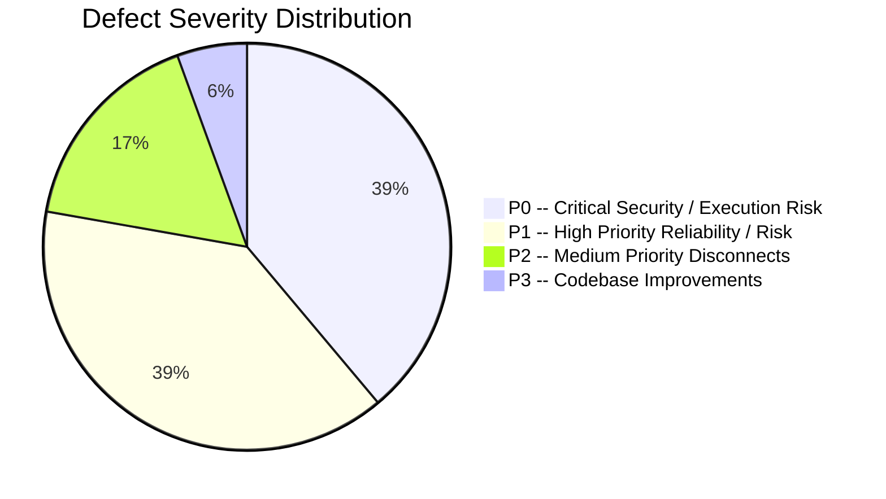
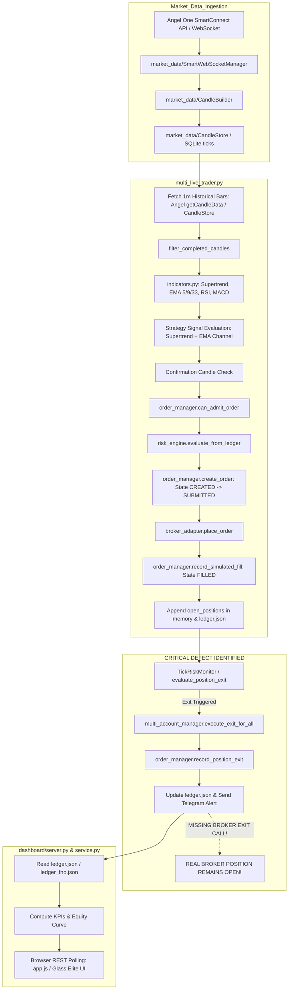

# PHASE 1 -- TECHNICAL AUDIT REPORT
## Day Trader Pro Engineering Assessment
**Date:** 2026-11-12 | **Assessment Mode:** READ-ONLY Comprehensive Audit | **Version:** 2.0.0-PRO  
**Repository:** `https://github.com/Gautam0324/trade`  
**Lead Auditors:** Principal Software Architect, Quantitative Trading Engineer, Full-Stack Engineer, QA Lead  

---

## 1. Executive Summary

This document presents the complete technical and security audit of the **Day Trader Pro** repository. The system is designed as an institutional algorithmic trading platform for Indian equity markets (NSE Cash) and equity derivatives (NFO Options), accompanied by a Glassmorphism web terminal and Telegram alert engine.

Our audit verified every subsystem directly against the live source code and execution paths. We identified **18 distinct architectural and implementation defects**, categorized across security, order lifecycle execution, risk management, quantitative sizing, and accounting.

### Defect Distribution by Severity
- **P0 (Critical Security & Catastrophic Financial Execution Risk):** 7 issues
- **P1 (High-Priority Reliability & Risk Engine Flaws):** 7 issues
- **P2 (Medium-Priority Architecture Disconnects & Look-Ahead Biases):** 3 issues
- **P3 (Improvements & Deprecations):** 1 issue
- **Total Findings:** 18



---

## 2. Actual Runtime Flow vs. Intended Architecture

### 2.1 Process Orchestration (`run.py`)
`run.py` launches 4 distinct child processes via Python `subprocess.Popen`:
1. `dashboard/server.py` (HTTP/REST server on port 10080)
2. `trader/multi_live_trader.py` (Cash Equity Multi-Symbol Engine)
3. `trader/fno_trader.py` (NIFTY & BANKNIFTY 1-min Index Options Engine)
4. `trader-alerts/telegram_onboarding.py` (Multi-user Telegram Chat ID onboarding daemon)

### 2.2 End-to-End Execution Trace
Below is the real execution flow observed in the production code:



### 2.3 Modules Actively Executed vs. Dead / Orphaned Code

| Module / Directory | Runtime Status | Evidence / Notes |
| :--- | :--- | :--- |
| `trader/multi_live_trader.py` | **ACTIVE** | Main production cash trading engine launched by `run.py`. |
| `trader/fno_trader.py` | **ACTIVE** | Main production index options engine launched by `run.py`. |
| `dashboard/server.py`, `service.py` | **ACTIVE** | Dashboard backend serving UI and REST API. |
| `trader-alerts/telegram_bot.py`, `telegram_onboarding.py` | **ACTIVE** | Telegram alert dispatch and user registration. |
| `trader/market_data/` | **ACTIVE** | WebSocket and tick ingest pipeline. |
| `trader/order_manager.py` | **ACTIVE** | Order lifecycle state machine. |
| `trader/risk_engine.py` | **ACTIVE** | Legacy risk engine used by `multi_live_trader.py`. |
| `trader/strategy_engine.py` | **ACTIVE** | Legacy strategy engine used by `multi_live_trader.py`. |
| `trader/v3_risk_engine.py` | **ORPHANED** | V3 risk engine; tested in `tests/test_v3_risk_engine.py` but never imported or invoked by runtime. |
| `trader/strategies/v3_trend_pullback.py` | **ORPHANED** | V3 strategy; never imported or wired into `multi_live_trader.py`. |
| `trader/db_v3.py` | **ORPHANED** | V3 SQLite schema; never imported by live runners. |
| `trader/accounting_engine.py` | **PARTIALLY USED** | Tested extensively, but `fno_trader.py` bypasses it in favor of ad-hoc functions. |
| `trader-pelosi/` | **DEAD / UNUSED** | Legacy Congressional trade scraper from older CLI skill. |
| `trader-news/` | **DEAD / UNUSED** | Standalone news scraper; not invoked in active loop. |
| `trader-analyst/` | **DEAD / UNUSED** | Standalone analyst script; not invoked in active loop. |
| `trader-timemachine/` | **DEAD / UNUSED** | Historical replay CLI script; not part of live daemon. |
| `trader-budget/` | **DEAD / UNUSED** | Legacy budget calculator superseded by `trader/config.json`. |
| `trader-broker/` | **DEAD / UNUSED** | Legacy broker adapter superseded by `trader/broker_adapter.py`. |

---

## 3. Investigation of Known Issues & Technical Defects

### Finding 1: Dashboard API Token Leaked in Public Unauthenticated GET Endpoint
- **Severity:** `P0 -- Critical Security Risk`
- **File:** `dashboard/server.py`
- **Function/Class:** `PremiumDashboardHandler.handle_api_get`
- **Line Numbers:** Line 163
- **Current Behavior:**
  ```python
  self.send_json({
      "account": account,
      "accounts": accounts_data.get("accounts", {}),
      "market_status": market_status,
      "trading_mode": "PAPER" if config.get("paper", True) else "LIVE",
      "ist_time": ist_time,
      "bot_status": daemon_info,
      "kpis": kpis,
      "config": service.sanitize_config(config),
      "api_token": DASHBOARD_API_TOKEN   # <--- LEAKED DIRECTLY TO CALLER
  })
  ```
  Anyone querying `GET /api/dashboard` (or `/api/status`) receives `DASHBOARD_API_TOKEN` in the plaintext JSON response.
- **Expected Behavior:** Secret administrative tokens must never be sent in API responses to unauthenticated clients. Authentication must use secure session cookies, HTTP Basic Auth, or pre-configured API keys.
- **Root Cause:** Inconvenience workaround during initial frontend development to pass the generated token to `app.js` without requiring user login.
- **Recommended Fix:** Require an explicit HTTP Authorization header or session cookie. The API token must be configured via environment variable `DASHBOARD_API_TOKEN` and entered by the user via a login prompt, not broadcast by the server.
- **Test Required:** `test_api_token_never_exposed_in_get_responses()` in `tests/test_dashboard.py`.

---

### Finding 2: Unauthenticated Dashboard Sensitive Financial GET Endpoints
- **Severity:** `P0 -- Critical Security / Information Disclosure Risk`
- **File:** `dashboard/server.py`
- **Function/Class:** `PremiumDashboardHandler.do_GET`
- **Line Numbers:** Lines 72–97
- **Current Behavior:** `do_GET()` verifies `validate_host_and_origin()` but does not call `validate_api_token()`. All portfolio balances, trade history, open positions, ledger records, and system health are accessible publicly.
- **Expected Behavior:** All endpoints returning real capital, account names, trade ledgers, or positions must enforce authentication.
- **Root Cause:** Token validation was only attached to `do_POST()`.
- **Recommended Fix:** Apply `validate_api_token()` to all `/api/*` paths in `do_GET()` except a designated `/api/auth/login` and `/health`.
- **Test Required:** `test_unauthenticated_get_returns_401()` in `tests/test_dashboard.py`.

---

### Finding 3: F&O Hardcoded Option Premium Fallback on Data Fetch Failure
- **Severity:** `P0 -- Catastrophic Financial Execution Risk`
- **File:** `trader/fno_trader.py`
- **Function/Class:** `FnoTraderEngine.evaluate_options_trade`
- **Line Numbers:** Lines 591–594
- **Current Behavior:**
  ```python
  # Fallback realistic ATM premium estimate if broker data unavailable
  if premium <= 0:
      premium = 85.0 if contract["underlying"] == "NIFTY" else 220.0
  ```
  If SmartAPI candle queries fail due to rate limits or off-hours, the engine fabricates a fictional premium of ₹85 (NIFTY) or ₹220 (BANKNIFTY).
- **Expected Behavior:** If live market premium data cannot be retrieved from the broker, the trade must be **aborted immediately**.
- **Root Cause:** Fallback placeholder intended for off-market testing remained in the live execution path.
- **Recommended Fix:** Delete the hardcoded fallback. If `premium <= 0`, log a high-priority warning and `return`.
- **Test Required:** `test_missing_quote_aborts_option_entry()` in `tests/test_fno.py`.

---

### Finding 4: Inaccurate Fixed-Delta (0.50) Option Exit Price Simulation
- **Severity:** `P1 -- High-Priority Risk / P&L Inaccuracy`
- **File:** `trader/fno_trader.py` and `dashboard/service.py`
- **Function/Class:** `FnoTraderEngine.monitor_open_positions` (line 721) and `service.compute_dashboard_metrics` (line 340)
- **Line Numbers:** Lines 719–722 in `fno_trader.py`; lines 340–342 in `service.py`
- **Current Behavior:**
  ```python
  spot_change = current_spot - pos.get("entry_spot", current_spot)
  delta = 0.50 if pos["option_type"] == "CE" else -0.50
  current_premium = max(1.0, round(entry_p + (spot_change * delta), 2))
  ```
  When live option candles cannot be retrieved, option price movement is modeled as 0.50 times underlying spot change.
- **Expected Behavior:** Real options pricing is non-linear, driven by Black-Scholes Greeks ($\Delta, \Gamma, \Theta, \nu$) and Implied Volatility. Linear delta assumption leads to artificial Target and Stop Loss hits, corrupting ledger accounting.
- **Root Cause:** Absence of real-time LTP quote subscription or Black-Scholes pricing model fallback.
- **Recommended Fix:** Fetch live LTP via SmartAPI Quote API (`getQuote`) or WebSocket tick stream. If unavailable, retain previous known price with stale flag rather than fabricating delta movement.
- **Test Required:** `test_option_exit_requires_live_quote_or_model()` in `tests/test_fno.py`.

---

### Finding 5: Cash Engine Creates Orders Without Checking Broker Order Response
- **Severity:** `P0 -- Critical Execution Risk / Phantom Position Risk`
- **File:** `trader/multi_live_trader.py`
- **Function/Class:** Main trading loop
- **Line Numbers:** Lines 799–805
- **Current Behavior:**
  ```python
  # 2d. Safe Order Routing via BrokerAdapter
  order_res = broker_adapter.place_order(sym, side, qty, c)

  # 2e. Simulated Fill & Position Creation (State: FILLED)
  fill_res = order_manager.record_simulated_fill(order_id, fill_price=c, fill_qty=qty)

  open_positions[sym] = {
      "id": fill_res["position_id"], ...
  }
  ```
  The return value `order_res` is completely ignored. If the broker rejects the order (e.g. margin short, circuit limit, network error), the bot records the position as filled locally.
- **Expected Behavior:** The engine must inspect `order_res.get("success")`. If rejected, transition order to `REJECTED`, record failure in audit log, and abort position creation.
- **Root Cause:** Blind assumption of synchronous success copied from paper simulation.
- **Recommended Fix:** Check `order_res.get("success")`. In live mode, poll order status via `broker_adapter.get_order_status(order_id)` before recording fill.
- **Test Required:** `test_rejected_broker_order_aborts_position()` in `tests/test_broker.py`.

---

### Finding 6: Silent Failure on Stop-Loss Order Placement
- **Severity:** `P0 -- Catastrophic Financial Exposure Risk`
- **File:** `trader/fno_trader.py` (lines 634–647) and `trader/multi_live_trader.py`
- **Function/Class:** `FnoTraderEngine.evaluate_options_trade` / `multi_live_trader.py`
- **Line Numbers:** `fno_trader.py` lines 634–647; `multi_live_trader.py` line 800
- **Current Behavior:**
  In `fno_trader.py`: If `place_stop_loss_order` fails or returns `{"success": False}`, the failure is silently ignored and trading continues with a completely naked position.
  In `multi_live_trader.py`: `place_stop_loss_order` is **never called at all** for cash equities. Stop losses only exist in software memory. If the bot crashes, positions have no exchange stop-loss.
- **Expected Behavior:** If stop-loss placement fails at the broker, the entry position must be immediately market squared off or retried with high alert.
- **Root Cause:** Lack of an atomic bracket order mechanism and missing error handler.
- **Recommended Fix:** If SL placement fails, immediately execute emergency exit on the fill and alert Telegram.
- **Test Required:** `test_sl_failure_triggers_emergency_exit()` in `tests/test_risk.py`.

---

### Finding 7: Cash Engine Never Dispatches Exit Orders to Live Broker
- **Severity:** `P0 -- Catastrophic Execution Risk (Unclosed Real Positions)`
- **File:** `trader/multi_live_trader.py`
- **Function/Class:** Main trading loop position management
- **Line Numbers:** Lines 535–570 (EOD session cutoff) and Lines 670–709 (Intraday signal exits)
- **Current Behavior:**
  When `evaluate_position_exit` returns `exit_trade=True`, `multi_live_trader.py` pops the position from memory, updates `order_manager`, writes to `ledger.json`, and sends a Telegram alert.
  **It never calls `broker_adapter.place_order(sym, "SELL", ...)`!**
- **Expected Behavior:** In live mode (`paper: false`), when an exit is triggered, a real sell/exit order must be transmitted to the broker and verified.
- **Root Cause:** The exit block was originally implemented for paper simulation, and the live dispatch call was omitted.
- **Recommended Fix:** Add `if broker_adapter.is_live(): broker_adapter.place_order(sym, "SELL", pos["quantity"], ...)` before updating ledger.
- **Test Required:** `test_live_exit_dispatches_sell_order_to_broker()` in `tests/test_paper_safeguards.py`.

---

### Finding 8: V3 Strategy Engine Completely Disconnected From Production Runtime
- **Severity:** `P1 -- Architecture Disconnect`
- **File:** `trader/multi_live_trader.py`
- **Line Numbers:** Lines 386–388
- **Current Behavior:** `multi_live_trader.py` imports and instantiates the older legacy `StrategyEngine` (`trader/strategy_engine.py`) and legacy `RiskEngine` (`trader/risk_engine.py`). `V3TrendPullbackStrategy` (`trader/strategies/v3_trend_pullback.py`) and `V3RiskEngine` (`trader/v3_risk_engine.py`) are never used.
- **Expected Behavior:** The master trading runner should load the production V3 multi-timeframe strategy and V3 risk engine as specified in the V3 architecture blueprint.
- **Root Cause:** V3 components were developed in isolation in Phase 6 without refactoring the legacy runner `multi_live_trader.py`.
- **Recommended Fix:** Refactor `multi_live_trader.py` to instantiate `V3TrendPullbackStrategy` and `V3RiskEngine`.
- **Test Required:** `test_runner_loads_v3_components()` in `tests/test_repo.py`.

---

### Finding 9: V3 Risk Engine Forces Minimum 1 Share Even If Risk Budget Exceeded
- **Severity:** `P1 -- Quantitative Risk Sizing Flaw`
- **File:** `trader/v3_risk_engine.py`
- **Function/Class:** `V3RiskEngine.calculate_position_size`
- **Line Numbers:** Lines 87–88, 92–93
- **Current Behavior:**
  ```python
  raw_qty = math.floor(risk_budget / risk_per_unit)
  qty = max(1, raw_qty)  # <--- FORCES QTY 1 EVEN IF RISK BUDGET < RISK PER UNIT!
  ```
  If `risk_budget` is ₹500 and `risk_per_unit` is ₹2,000, `raw_qty = 0`. The code forces `qty = 1`, resulting in a ₹2,000 risk (4x the allowed budget).
- **Expected Behavior:** If `raw_qty == 0`, the trade must be rejected with `"Risk per unit exceeds allowable risk budget"`.
- **Root Cause:** Misuse of `max(1, raw_qty)` to avoid zero-quantity errors.
- **Recommended Fix:** If `raw_qty < 1: return 0, 0.0, ["Risk per share exceeds risk budget"]`.
- **Test Required:** `test_position_sizing_rejects_when_unit_risk_exceeds_budget()` in `tests/test_v3_risk_engine.py`.

---

### Finding 10: Arbitrary 10% Tolerance Over Strict Concurrent Open Risk Limit
- **Severity:** `P2 -- Risk Limit Invariant Violation`
- **File:** `trader/v3_risk_engine.py`
- **Function/Class:** `V3RiskEngine.evaluate_account_risk`
- **Line Numbers:** Line 177
- **Current Behavior:**
  ```python
  if (current_open_risk + planned_risk) > (max_total_open_risk * 1.10): # 10% buffer
  ```
  Allows total open risk to reach 1.1% of capital despite the institutional rule mandating a strict 1.0% maximum.
- **Expected Behavior:** Risk limits must be hard barriers without arbitrary padding.
- **Root Cause:** Ad-hoc buffer added to prevent marginal rejections.
- **Recommended Fix:** Remove `* 1.10`. Compare directly against `max_total_open_risk`.
- **Test Required:** `test_strict_open_risk_limit_without_tolerance()` in `tests/test_v3_risk_engine.py`.

---

### Finding 11: WebSocket Candle Stream Bypasses Completed-Bar Filtering
- **Severity:** `P1 -- Incomplete Candle Signal Distortion`
- **File:** `trader/multi_live_trader.py`
- **Line Numbers:** Lines 608–611
- **Current Behavior:**
  ```python
  cached_candles = candle_store.get_candles(sym, "1m", limit=100)
  if len(cached_candles) >= 10:
      completed_bars = [[c["timestamp"], c["open"], c["high"], c["low"], c["close"], c["volume"]] for c in cached_candles]
  ```
  Unlike the REST fallback (which calls `filter_completed_candles`), the WebSocket branch takes the last candle directly from `candle_store`. If `candle_builder` emitted an in-progress bar, indicators run on an unclosed candle.
- **Expected Behavior:** Strategy and indicators must only compute on confirmed, closed candles.
- **Root Cause:** Asymmetry between WebSocket path and REST fallback path.
- **Recommended Fix:** Pass `cached_candles` through `filter_completed_candles(..., current_time_str)` on all branches.
- **Test Required:** `test_websocket_stream_discards_forming_candle()` in `tests/test_candle_builder.py`.

---

### Finding 12: Backtesting Look-Ahead Bias and In-Bar Fill Assumptions
- **Severity:** `P2 -- Quantitative Research Defect`
- **File:** `trader/backtest_exact_pinescript.py` and `trader/backtest_nifty_today.py`
- **Line Numbers:** Lines 68–84, 183–187 in `backtest_exact_pinescript.py`
- **Current Behavior:**
  1. Entire series of EMA, Supertrend, and MACD indicators is calculated upfront across all bars.
  2. Signal confirmation occurs on candle `i` close `c`, and the trade enters at the exact same close `c` of bar `i` without slippage.
  3. Exit logic evaluates only close `c` rather than inspecting bar `low` or `high` for stop-loss breaches.
- **Expected Behavior:** Backtests must compute indicators incrementally bar-by-bar, enter on the `open` of bar `i+1` with realistic slippage, and evaluate intra-bar stop-loss triggers.
- **Root Cause:** Script written to replicate TradingView Pine Script visual output rather than physical order fills.
- **Recommended Fix:** Use event-driven bar simulation with next-bar open entry.
- **Test Required:** `test_backtest_no_lookahead_entry()` in `tests/test_backtesting.py`.

---

### Finding 13: Multiple Conflicting Statutory Fee & Cost Models
- **Severity:** `P1 -- Accounting Inconsistency`
- **File:** `trader/accounting_engine.py`, `trader/cost_model.py`, and `trader/fno_trader.py`
- **Line Numbers:** `accounting_engine.py` line 25; `cost_model.py` line 30; `fno_trader.py` line 138
- **Current Behavior:**
  - `fno_trader.py` computes STT at `0.1%` (`0.001`).
  - `accounting_engine.py` computes Options STT at `0.0625%` (`0.000625`).
  - `cost_model.py` has separate equity fee tables.
  Three different modules calculate taxes with conflicting rates.
- **Expected Behavior:** Single source of truth for Indian regulatory statutory charges (SEBI/NSE/STT/GST).
- **Root Cause:** Multiple developers implemented fee calculation independently across different sprints.
- **Recommended Fix:** Deprecate `calculate_option_costs()` in `fno_trader.py` and unify all cost calculations under `AccountingEngine`.
- **Test Required:** `test_unified_accounting_engine_across_all_runners()` in `tests/test_accounting_engine.py`.

---

### Finding 14: Automated Test Coverage Gaps on Live Execution Engines
- **Severity:** `P1 -- Quality Assurance Gap`
- **File:** `tests/`
- **Current Behavior:** The test suite has 456 passing tests, but:
  - `trader/fno_trader.py` has **0 unit or integration tests**.
  - `trader/multi_live_trader.py` main event loop is untested (only isolated candle and exit helpers).
  - Live broker error responses and network retry logic are untested.
- **Expected Behavior:** High test coverage on all critical financial order placement and risk cutoff routines.
- **Root Cause:** Fast iteration on terminal features left runner daemons without mock harnesses.
- **Recommended Fix:** Create `tests/test_fno_trader.py` and `tests/test_multi_trader_integration.py` using mock SmartAPI fixtures.
- **Test Required:** Mock test suite validating runner startup, tick processing, order routing, and shutdown.

---

### Finding 15: Dual-Gate Paper/Live OrderManager Fill Desynchronization
- **Severity:** `P3 -- Architecture Improvement / Fill Synchronization`
- **File:** `trader/multi_live_trader.py` and `trader/order_manager.py`
- **Line Numbers:** Line 802 in `multi_live_trader.py`
- **Current Behavior:**
  When `paper: false`, `multi_live_trader.py` calls `order_manager.record_simulated_fill(...)`. It treats the order as filled immediately at the candle close price without waiting for broker order status or actual executed price.
- **Expected Behavior:** In live trading, an order must remain in `SUBMITTED` until the broker returns `COMPLETE` with real `fill_price` and `fill_qty`.
- **Root Cause:** Lack of asynchronous execution handler in `OrderManager`.
- **Recommended Fix:** Implement `record_broker_fill(order_id, fill_price, fill_qty)` in `OrderManager` and poll orderbook in live mode.
- **Test Required:** `test_order_manager_awaits_real_broker_fill()` in `tests/test_order_manager.py`.

---

### Finding 16: Ledger Multi-File Concurrency Race Condition
- **Severity:** `P1 -- Data Integrity Risk`
- **File:** `trader/fno_trader.py` and `trader/multi_live_trader.py`
- **Line Numbers:** Lines 730–731 in `fno_trader.py`
- **Current Behavior:** `fno_trader.py` writes to `ledger_fno.json` and simultaneously iterates through and modifies `ledger.json`, `ledger_himanshu.json`, and `ledger_prateek.json` via `update_open_option_on_all_ledgers()`. Simultaneously, `multi_live_trader.py` writes to `ledger.json`. Neither process uses file locks for cross-process writes.
- **Expected Behavior:** File writes across independent processes must be protected by atomic locks (e.g. `portalocker` or SQLite transactions).
- **Root Cause:** Independent processes sharing flat JSON files without inter-process synchronization.
- **Recommended Fix:** Migrate position and trade storage to SQLite (`trader_v3.db`) with `WAL` mode and atomic transactions.
- **Test Required:** `test_concurrent_ledger_writes()` in `tests/test_ledger.py`.

---

### Finding 17: Dashboard Host Validation Weakness
- **Severity:** `P2 -- Security Configuration Issue`
- **File:** `dashboard/server.py`
- **Function/Class:** `PremiumDashboardHandler.validate_host_and_origin`
- **Line Numbers:** Lines 39–56
- **Current Behavior:**
  The server explicitly blocks `evil.com` and `attacker.com`, but allows any other unknown host header.
- **Expected Behavior:** Strict whitelist containing only allowed IPs/domains (localhost, 127.0.0.1, server public IP, and authorized DNS domains).
- **Root Cause:** Blacklist approach used instead of whitelist approach to allow easy VPS deployment.
- **Recommended Fix:** Allow configuration of `ALLOWED_HOSTS` in environment variables.
- **Test Required:** `test_host_header_whitelist()` in `tests/test_dashboard.py`.

---

### Finding 18: Unhedged Crash Exposure (Missing Exchange-Level Stop Loss for Cash)
- **Severity:** `P0 -- Financial Invariant Violation`
- **File:** `trader/multi_live_trader.py`
- **Line Numbers:** Lines 804–809
- **Current Behavior:** Cash equity positions rely strictly on software-loop tick monitoring for stop losses. No stop-loss order is placed at the exchange.
- **Expected Behavior:** Institutional trading standards mandate that every open intraday position must have a resting stop-loss order at the exchange.
- **Root Cause:** Omission of `place_stop_loss_order` call in `multi_live_trader.py`.
- **Recommended Fix:** Immediately dispatch `broker_adapter.place_stop_loss_order(...)` upon receiving confirmed entry fill.
- **Test Required:** `test_cash_equity_places_exchange_sl()` in `tests/test_broker.py`.

---

## 4. Summary Matrix of Findings

| ID | Finding Title | Severity | Component | File Path |
| :--- | :--- | :--- | :--- | :--- |
| **F-01** | Dashboard API Token Leaked in Public GET API | **P0** | Security | `dashboard/server.py:163` |
| **F-02** | Unauthenticated Financial GET Endpoints | **P0** | Security | `dashboard/server.py:72` |
| **F-03** | F&O Hardcoded Option Premium Fallbacks | **P0** | Trading | `trader/fno_trader.py:593` |
| **F-05** | Cash Orders Created Without Broker Fill Confirmation | **P0** | Execution | `trader/multi_live_trader.py:802` |
| **F-06** | Silent Failure on Stop-Loss Placement | **P0** | Risk | `trader/fno_trader.py:644` |
| **F-07** | Cash Engine Never Dispatches Exit Orders to Live Broker | **P0** | Execution | `trader/multi_live_trader.py:670` |
| **F-18** | Missing Exchange-Level Stop Loss for Cash Positions | **P0** | Risk | `trader/multi_live_trader.py:804` |
| **F-04** | Fixed-Delta (0.50) Option Exit Price Simulation | **P1** | Derivatives | `trader/fno_trader.py:721` |
| **F-08** | V3 Strategy Disconnected From Production Runtime | **P1** | Architecture | `trader/multi_live_trader.py:387` |
| **F-09** | V3 Risk Engine Forces Qty 1 Exceeding Risk Budget | **P1** | Risk | `trader/v3_risk_engine.py:88` |
| **F-11** | WebSocket Stream Bypasses Completed-Bar Filtering | **P1** | Market Data | `trader/multi_live_trader.py:610` |
| **F-13** | Multiple Conflicting Statutory Fee & Cost Models | **P1** | Accounting | `trader/fno_trader.py:124` |
| **F-14** | Automated Test Coverage Gaps on Live Execution Engines | **P1** | QA | `tests/` |
| **F-16** | Cross-Process Flat JSON Ledger Concurrency Collisions | **P1** | Storage | `trader/fno_trader.py:730` |
| **F-10** | Arbitrary 10% Tolerance Over Strict Open Risk Limit | **P2** | Risk | `trader/v3_risk_engine.py:177` |
| **F-12** | Backtesting Look-Ahead Bias & In-Bar Fill Assumptions | **P2** | Backtesting | `trader/backtest_exact_pinescript.py:184` |
| **F-17** | Dashboard Host Blacklist Instead of Whitelist | **P2** | Security | `dashboard/server.py:44` |
| **F-15** | Dual-Gate Simulated Fill Call in Live Mode | **P3** | Architecture | `trader/multi_live_trader.py:802` |

