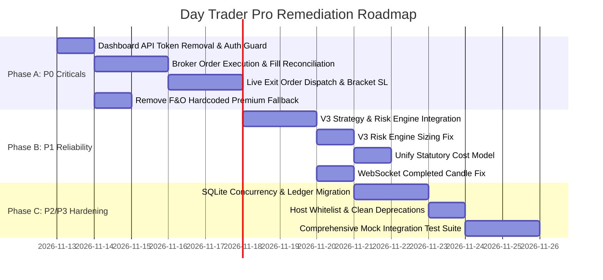

# PHASE 1 -- REMEDIATION & IMPLEMENTATION PLAN
## Day Trader Pro Engineering Roadmap
**Date:** 2026-11-12 | **Assessment Mode:** Prioritized Execution Strategy | **Version:** 2.0.0-PRO  
**Repository:** `https://github.com/Gautam0324/trade`  
**Author:** Quantitative Trading Architect & Full-Stack Lead  

---

## 1. Remediation Strategy & Guiding Principles

Before transitioning from paper simulation to live real-money execution, every critical security vulnerability (P0) and financial execution risk (P0/P1) must be resolved and verified with automated regression tests.

### Non-Negotiable Operational Principles:
1. **Safety First:** Zero live broker orders may be dispatched until fill verification, exchange stop-loss placement, and broker exit dispatch are tested and confirmed.
2. **Deterministic State:** No position may ever exist in the ledger unless confirmed filled by the broker order book.
3. **Strict Account Isolation:** One account's drawdown or trade sizing must never bleed into another account's balance or risk limits.
4. **No Code Without Tests:** Every bug fix must be accompanied by an automated test case. The existing 456 test suite must remain 100% green.

---

## 2. Prioritized Implementation Roadmap



---

## 3. Detailed Work Breakdown by Severity

### Phase A: P0 Critical Security & Financial Execution Fixes (Immediate Priority)

#### Work Package A.1: Secure Dashboard Authentication & Token Protection (Findings F-01, F-02, F-17)
- **Target Files:** `dashboard/server.py`, `dashboard/app.js`
- **Actions:**
  1. Remove `"api_token": DASHBOARD_API_TOKEN` from line 163 in `server.py`.
  2. Implement `validate_api_token()` across `do_GET()` for all `/api/*` routes.
  3. Provide `/api/auth/login` endpoint that validates password / token and sets an `HttpOnly` session cookie or returns an auth session.
  4. In `app.js`, add a sleek Glassmorphism token/password modal if unauthenticated, storing token in `sessionStorage`.
  5. Replace blacklist host check with `ALLOWED_HOSTS` whitelist.
- **Verification Gate:**
  `curl http://localhost:10080/api/dashboard` must return `401 Unauthorized`.
  `curl -H "X-API-Token: <valid_token>" http://localhost:10080/api/dashboard` must return `200 OK`.
  `tests/test_dashboard.py` must pass.

#### Work Package A.2: F&O Safety Hardening -- Abort on Missing Market Data (Finding F-03)
- **Target Files:** `trader/fno_trader.py`
- **Actions:**
  1. Delete lines 591–594 (`premium = 85.0 if contract["underlying"] == "NIFTY" else 220.0`).
  2. If `premium <= 0` or broker query fails: log `[F&O DATA ERROR] Live premium unavailable for {opt_sym}. ABORTING order placement.` and `return`.
- **Verification Gate:**
  Simulate failed SmartAPI candle query; verify no order is dispatched and position count remains 0.

#### Work Package A.3: Live Order Placement Verification & Fill Confirmation (Finding F-05, F-15)
- **Target Files:** `trader/multi_live_trader.py`, `trader/order_manager.py`, `trader/broker_adapter.py`
- **Actions:**
  1. In `multi_live_trader.py:799`, inspect `order_res`:
     ```python
     if not order_res.get("success"):
         order_manager.update_order_status(order_id, OrderState.REJECTED, reason=order_res.get("reason"))
         log_audit_event("ORDER_REJECTED", {"symbol": sym, "reason": order_res.get("reason")})
         del pending_signals[sym]
         continue
     ```
  2. In live mode (`paper: false`), poll `broker_adapter.get_order_status(order_id)` until status is `COMPLETE`. Extract real `fill_price` and real `fill_qty`. Only then invoke `order_manager.record_fill(...)` and register `open_positions`.
- **Verification Gate:**
  Unit tests in `tests/test_broker.py` simulating rejected broker responses must verify zero phantom positions created.

#### Work Package A.4: Live Exit Order Dispatch & Broker Stop-Loss Placement (Findings F-06, F-07, F-18)
- **Target Files:** `trader/multi_live_trader.py`, `trader/broker_adapter.py`
- **Actions:**
  1. In `multi_live_trader.py` entry logic: Immediately place exchange stop-loss order via `broker_adapter.place_stop_loss_order(...)`.
  2. If SL placement fails at broker: Immediately market exit the entry position to prevent unhedged exposure.
  3. In `multi_live_trader.py` exit logic (lines 540–560 and 670–685):
     ```python
     if broker_adapter.is_live():
         # 1. Cancel resting SL order at broker
         broker_adapter.cancel_order(pos.get("broker_sl_order_id"))
         # 2. Transmit market exit order
         exit_res = broker_adapter.place_order(sym, "SELL", pos["quantity"], exit_price, order_type="MARKET")
         if not exit_res.get("success"):
             # Raise critical alert
             telegram_bot.send_telegram_message(f"🚨 CRITICAL: Broker Exit Failed for {sym}!")
     ```
- **Verification Gate:**
  Automated integration test verifying that triggering an exit calls `place_order` with `side="SELL"`.

---

### Phase B: P1 Reliability, Quantitative Risk, and Strategy Integration

#### Work Package B.1: V3 Strategy & Risk Engine Integration (Finding F-08)
- **Target Files:** `trader/multi_live_trader.py`, `trader/v3_risk_engine.py`, `trader/strategies/v3_trend_pullback.py`
- **Actions:**
  1. Replace legacy `StrategyEngine` with `V3TrendPullbackStrategy`.
  2. Replace legacy `RiskEngine` with `V3RiskEngine`.
  3. Ensure multi-timeframe candle aggregations (1m $\to$ 5m $\to$ 15m) are fed to V3 strategy.
- **Verification Gate:**
  Run `tests/test_v3_engine.py` and `tests/test_v3_strategy.py`.

#### Work Package B.2: V3 Risk Engine Position Sizing Bug Fix (Findings F-09, F-10)
- **Target Files:** `trader/v3_risk_engine.py`
- **Actions:**
  1. Remove `qty = max(1, raw_qty)` in `calculate_position_size`. If `raw_qty < 1`, reject order.
  2. Remove `* 1.10` tolerance in line 177. Enforce exact 1.0% concurrent open risk barrier.
- **Verification Gate:**
  Add unit test where unit risk is 2x risk budget; verify quantity is 0 and trade rejected.

#### Work Package B.3: Unified Statutory Cost Model (Finding F-13)
- **Target Files:** `trader/accounting_engine.py`, `trader/fno_trader.py`, `trader/cost_model.py`
- **Actions:**
  1. Deprecate `calculate_option_costs()` in `fno_trader.py`.
  2. Import and use `AccountingEngine.calculate_trade_costs(segment="OPTIONS", ...)` in `fno_trader.py` and `dashboard/service.py`.
- **Verification Gate:**
  Ledger P&L, statement reports, and audit logs produce identical numbers across both desks.

#### Work Package B.4: Completed-Candle Stream Synchronization (Finding F-11)
- **Target Files:** `trader/multi_live_trader.py`
- **Actions:**
  Pass cached candles from `CandleStore` through `filter_completed_candles(..., current_time_str)` so indicators never calculate on forming bars.
- **Verification Gate:**
  Unit test ensuring candles with current timestamp are stripped.

---

### Phase C: P2/P3 Architecture Hardening & Concurrency Safety

#### Work Package C.1: Cross-Process Concurrency Safety (Finding F-16)
- **Target Files:** `trader/ledger.py`, `trader/ledger_utils.py`, `trader/fno_trader.py`
- **Actions:**
  Use file-level read/write locking via atomic file replacement (`tempfile` + `os.replace`) or migrate ledger records into `trader_v3.db` with SQLite WAL mode.
- **Verification Gate:**
  Concurrent write test script without file corruption.

#### Work Package C.2: Clean Deprecation of Dead Modules
- Move `trader-pelosi/`, `trader-news/`, `trader-analyst/`, `trader-timemachine/`, `trader-budget/` into an `archive/` or remove from active workspace to eliminate cognitive clutter.

---

## 4. Live Real-Money Safety Checklist (Pre-Flight Gate)

Do NOT set `"paper": false` in `trader/config.json` until every item below is verified:

- [ ] **Auth Gate Active:** Dashboard GET and POST endpoints require authentication; token not leaked.
- [ ] **Live Fills Reconciled:** OrderManager awaits confirmed execution from Angel One order book.
- [ ] **Exchange SL Placed:** Every live order immediately places an exchange `STOPLOSS_LIMIT` order.
- [ ] **Live Exit Orders Active:** Exits dispatch real `SELL` orders to Angel One and cancel resting stop-losses.
- [ ] **No Hardcoded Premiums:** `fno_trader.py` strictly aborts if quotes are missing.
- [ ] **Strict 1% Risk Sizing:** `V3RiskEngine` does not force `qty=1` when risk budget is exceeded.
- [ ] **Pilot Phase 1 Passed:** 1-share live equity test completed with verified buy, SL placement, and sell execution.
- [ ] **All 456+ Unit Tests Passing:** Zero test regressions.

