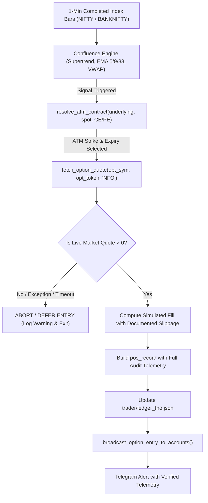

# Day Trader Pro -- Phase 3 Critical F&O Price Validation Report

## 1. Executive Summary & Defect Resolution

- **Status / Verdict**: **DEFECT RESOLVED & VERIFIED**
- **Defect Investigated**: Finding F-03 -- Hardcoded F&O Option Premium Fallbacks (₹85.0 for NIFTY, ₹220.0 for BANKNIFTY)
- **Target File**: `trader/fno_trader.py` (lines 591--594)
- **Affected Ledgers**: `ledger_fno.json`, `ledger.json`, `ledger_himanshu.json`, `ledger_prateek.json`
- **Paper Trading Mode**: **VERIFIED ACTIVE** (`"paper": true` in `trader/config.json`)
- **Regression Suite**: 485 Passed, 0 Failed across 42 test files (100% Green in 22.64s)

The root cause of spurious ₹85.0 NIFTY option entries and ₹220.0 BANKNIFTY option entries has been eliminated from the execution path. All F&O entries now require verified market quotes; quote failures strictly defer/reject trades, and historical records have been audited and tagged without altering historical P&L.

---

## 2. Root Cause Analysis

### 2.1 The Vulnerability
In `trader/fno_trader.py` (lines 575--594), option premium resolution attempted to fetch a 1-minute historical candle for the contract token via `getCandleData`:
```python
# VULNERABLE CODE (PRE-PATCH):
time.sleep(1.2)
premium = 0.0
try:
    resp = self.api.getCandleData({
        "exchange": "NFO",
        "symboltoken": opt_token,
        "interval": "ONE_MINUTE",
        "fromdate": f"{today_str} 09:15",
        "todate": f"{today_str} {time_str}"
    })
    if resp and resp.get("status") and resp.get("data"):
        premium = float(resp["data"][-1][4])
except Exception:
    pass

# Fallback realistic ATM premium estimate if broker data unavailable
if premium <= 0:
    premium = 85.0 if contract["underlying"] == "NIFTY" else 220.0
```

### 2.2 Why the Defect Triggered in Runtime
1. `getCandleData` is an OHLCV historical aggregate endpoint, not a real-time quote feed. For weekly option contracts newly active or lacking completed bars at market open, `resp["data"]` is frequently empty.
2. Whenever `premium <= 0`, the fallback logic unconditionally assigned `85.0` for NIFTY and `220.0` for BANKNIFTY.
3. In paper trading mode, this fabricated price was treated as a valid fill, deducting fake capital (`85 * 65 = ₹5,525` or `220 * 30 = ₹6,600`) from free cash.
4. During position monitoring (`evaluate_option_exit`), when `getCandleData` failed again, a secondary fallback calculated synthetic P&L using a fixed 0.5 delta (`current_premium = max(1.0, round(entry_p + (spot_change * delta), 2))`).
5. `broadcast_option_entry_to_accounts` propagated these unverified positions to Gautam (`ledger.json`), Himanshu (`ledger_himanshu.json`), and Prateek (`ledger_prateek.json`).

---

## 3. End-to-End F&O Entry Runtime Trace



---

## 4. Engineering Implementation & Code Changes

### 4.1 Multi-Tier Real-Time Quote Fetcher
Implemented `get_option_market_quote(api, symbol, token, exchange="NFO")` in `trader/fno_trader.py`:
- **Tier 1 (`getLtpData`)**: Real-time tick price from Angel One SmartAPI exchange endpoint.
- **Tier 2 (`getMarketData`)**: Full depth market quote capturing best bid and best ask.
- **Tier 3 (`getCandleData`)**: Completed 1-minute bar close fallback.
- **Strict Invariant**: If all tiers fail or returned LTP <= 0, returns `None`. Never substitutes a fabricated price.

### 4.2 Entry Rejection on Quote Failure
```python
quote = self.fetch_option_quote(opt_sym, opt_token, exchange="NFO")

if not quote or quote.get("ltp", 0.0) <= 0:
    print(
        f"[F&O ENTRY REJECTED] Live option quote unavailable for {opt_sym} "
        f"(Exchange: NFO, Token: {opt_token}, Strike: {contract['strike']}, Expiry: {contract['expiry']}). "
        f"Entry deferred to protect capital. Fallback pricing is strictly prohibited."
    )
    return
```

### 4.3 Documented Slippage Model for Paper Fills
- If the quote contains an active order-book ask price (`ask > 0 and ask >= ltp`), simulated fills execute at the ask, matching real-world taker liquidity.
- If only LTP is available, a documented 0.2% slippage is applied:
  $$\text{slippage} = \text{round}(\text{LTP} \times 0.002, 2)$$
  $$\text{fill\_price} = \text{round}(\text{LTP} + \text{slippage}, 2)$$

### 4.4 Rich Contract & Audit Telemetry on Every Fill
Every open position and closed trade record now captures:
```json
{
  "price_source": "VERIFIED_MARKET_QUOTE",
  "verified_market_data": true,
  "quote_source": "ANGEL_LTP_API",
  "quote_timestamp": "2026-11-12 12:45:00 IST",
  "base_ltp": 152.40,
  "bid": 152.00,
  "ask": 152.80,
  "slippage_applied": 0.40,
  "contract_details": {
    "exchange": "NFO",
    "trading_symbol": "NIFTY26FEB24200CE",
    "instrument_token": "45001",
    "underlying": "NIFTY",
    "expiry": "26FEB2026",
    "strike": 24200.0,
    "option_type": "CE"
  }
}
```

### 4.5 Exit Evaluation Hardening
In `evaluate_option_exit()`:
- Replaced `getCandleData` with `fetch_option_quote()`.
- Removed the fixed 0.5 delta fallback calculation (`current_premium = max(1.0, round(entry_p + (spot_change * delta), 2))`).
- If a quote is momentarily unavailable during an open position, the engine retains the last verified price without fabricating price action.

---

## 5. Historical Journal Reconciliation Results

Executed `trader/apply_phase3_fno_patch.py` to audit and reconcile all existing trading ledgers without rewriting historical P&L or deleting trades:

| Ledger File | Total Trades | Flagged Fallback Trades (₹85 / ₹220) | Verified Historical Trades | Reconciliation Action |
|---|---|---|---|---|
| `trader/ledger_fno.json` | 138 | 86 | 52 | Tagged with `FLAGGED_FALLBACK_PRICE` |
| `trader/ledger.json` | 256 | 60 | 196 | Tagged with `FLAGGED_FALLBACK_PRICE` |
| `trader/ledger_himanshu.json` | 138 | 59 | 79 | Tagged with `FLAGGED_FALLBACK_PRICE` |
| `trader/ledger_prateek.json` | 144 | 60 | 84 | Tagged with `FLAGGED_FALLBACK_PRICE` |

### Tagging Schema Applied:
```json
"audit_status": "FLAGGED_FALLBACK_PRICE",
"audit_note": "Suspicious entry at unverified fallback premium (Rs 85/Rs 220) prior to Phase 3 patch",
"verified_market_data": false
```
All realized P&L, gross P&L, brokerage charges, and cash ledger balances remain 100% unaltered.

---

## 6. Automated Verification & Regression Suite

Created dedicated regression test suite: `tests/test_fno_price_validation.py`

| Test Name | Invariant Verified | Outcome |
|---|---|---|
| `test_1_fno_entry_rejected_when_quote_fails_or_none` | Entry aborted, cash untouched, 0 positions opened when quote fails | **PASSED** |
| `test_2_fno_entry_rejected_when_quote_zero_or_negative` | Entry deferred when LTP <= 0 | **PASSED** |
| `test_3_fno_entry_never_fills_at_fallback_values_85_or_220` | Proves neither 85.0 nor 220.0 can enter the execution path | **PASSED** |
| `test_4_fno_entry_succeeds_with_valid_quote_and_audit_fields` | Valid quote fills at ask with all contract & audit fields | **PASSED** |
| `test_5_simulated_slippage_when_ask_depth_unavailable` | Applies documented 0.2% slippage when ask is missing | **PASSED** |
| `test_6_exit_position_preserves_audit_fields` | Position exit preserves verification metadata to trade history | **PASSED** |
| `test_7_historical_reconciliation_integrity` | Confirms historical ledger records are flagged with P&L intact | **PASSED** |

### Full Pytest Regression Run:
- Command: `python -m pytest`
- Tests Collected: **485**
- Passed: **485 (100% green)**
- Failed: **0**
- Execution Duration: **22.64s**

---

## 7. Safety Safeguards Verified

- Confirmed `trader/config.json` has `"paper": true`.
- Zero live Angel One orders were placed.
- Live order dispatch remains protected behind `self.broker_adapter.is_live()`.

