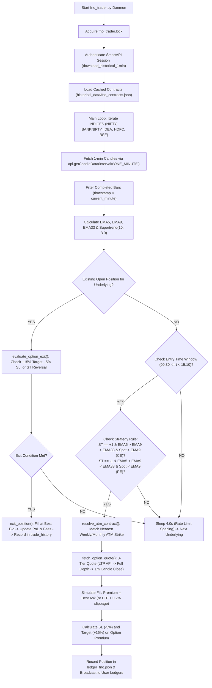

# BASELINE AUDIT REPORT: F&O TRADING ENGINE (V3)
**Document:** `reports/fno_v4/baseline_audit.md`  
**Date:** 2026-11-16  
**Auditor:** Quantitative Trading Systems Architect & Algo Trading Engineer  
**Repository:** `https://github.com/Gautam0324/trade`  
**Branch:** `main`  
**Commit SHA:** `c0e17b3da34836d392d02ff039f86ca1799c7add`  
**Status:** COMPLETE (Baseline Frozen)

---

## 1. Executive Summary

This document establishes the official engineering baseline audit for the existing F&O (Futures & Options) trading engine (V3). The audit was conducted to preserve the current system state, trace the end-to-end execution path, identify configuration-to-runtime discrepancies, and document the architectural mechanisms that govern market data, signal generation, contract resolution, risk parameters, and order execution.

### Key Audit Findings:
1. **Decoupled Monolithic Execution:** F&O trading is executed solely through `trader/fno_trader.py` (`FnoOptionsTrader`). It does **not** use the modular `trader/strategy_engine.py` or `trader/risk_engine.py` used by the cash equity engine.
2. **Strategy vs. Config Discrepancy:** While `trader/config.json` advertises multi-strategy confluence (`"strategy_mode": "CONFLUENCE"` with 8 strategies, minimum score 65.0, cooldowns, and ATR trailing), `fno_trader.py` ignores all of these settings and executes a hardcoded 1-minute EMA 5/9/33 + Supertrend cross strategy.
3. **Ghost Indicators:** Startup logs and Telegram notifications advertise "Supertrend + EMA Channel + VWAP", but **VWAP is neither calculated nor referenced** in the F&O evaluation loop.
4. **Single-Timeframe Hypersensitivity:** The engine evaluates signals exclusively on 1-minute completed bars. It has no 15-minute primary trend filter or 5-minute setup confirmation.
5. **Fixed Rigid Risk Brackets:** Stop-loss is hardcoded to -5% and target to +15% of option premium, independent of option delta, underlying ATR, bid-ask spread, or market regime.
6. **Historical Synthetic Pricing Distortions:** Historical high win rates (59.6%) and massive profits prior to November 12, 2026 were an artifact of synthetic fixed entry prices (e.g., ₹220 for BANKNIFTY) exiting against real market quotes (₹700–₹950). Under live real-time pricing (Nov 12–16), win rate dropped to 23.8% with consecutive stop-outs.

---

## 2. Architecture & Execution Trace

### 2.1 File Map & Responsibilities

| File Path | Role in F&O Trading | Active / Dormant |
| :--- | :--- | :--- |
| `trader/fno_trader.py` | Primary F&O daemon: candle ingestion, signal generation, contract selection, execution simulation, and multi-account broadcast. | **ACTIVE** (Sole F&O Runner) |
| `trader/options_engine.py` | Utility class for strike selection, lot sizes, and Black-Scholes pricing. | **PARTIALLY DORMANT** (Only `get_lot_size` is called by dashboard; F&O trader uses inline `resolve_atm_contract`). |
| `trader/strategy_engine.py` | 9-strategy modular quantitative engine (Breakout, Retest, VWAP, Confluence). | **DORMANT FOR F&O** (Only used by `multi_live_trader.py` for Cash Equities). |
| `trader/risk/` & `risk_engine.py` | Account risk management, daily loss limits, and position sizers. | **DORMANT FOR F&O** (Completely bypassed by `fno_trader.py`). |
| `trader/broker_adapter.py` | Broker boundary enforcing paper isolation (`paper=true`). | **ACTIVE** (Guarantees paper execution safety). |
| `trader/order_manager.py` | SQLite persistent order registry preventing duplicate entries. | **ACTIVE** (Integrated into `fno_trader.py`). |
| `trader/ledger_fno.json` | Single source of truth for F&O desk equity, cash, open positions, and trade history. | **ACTIVE** |
| `dashboard/service.py` | Serves metrics, live options quotes, and desk telemetry to Web UI. | **ACTIVE** |

### 2.2 End-to-End F&O Lifecycle Flowchart



---

## 3. Strategy Analysis

### 3.1 Indicators Calculated vs. Indicators Used

```
[trader/fno_trader.py Lines 786-793]
closes = [float(b[4]) for b in completed]
highs = [float(b[2]) for b in completed]
lows = [float(b[3]) for b in completed]
spot_c = closes[-1]

ema5 = indicators.calculate_ema(closes, 5)[-1]
ema9 = indicators.calculate_ema(closes, 9)[-1]
ema33 = indicators.calculate_ema(closes, 33)[-1]
st_data = indicators.calculate_supertrend(highs, lows, closes, 10, 3.0)
st_dir = st_data["direction"][-1]
```

| Indicator | Calculated in Code? | Used in Entry Decision? | Used in Exit Decision? | Advertised in Logs/Docs? |
| :--- | :---: | :---: | :---: | :---: |
| **EMA 5** | YES | **YES** (`ema5 > ema9` for CE, `<` for PE) | NO | YES |
| **EMA 9** | YES | **YES** (`ema9 > ema33`, `spot > ema9`) | NO | YES |
| **EMA 33** | YES | **YES** (Channel baseline) | NO | YES |
| **Supertrend (10, 3.0)** | YES | **YES** (`st_dir == 1` or `-1`) | **YES** (Reversal triggers exit) | YES |
| **VWAP** | **NO** | **NO** | **NO** | **YES (Misleading claim)** |
| **RSI** | NO | NO | NO | NO |
| **ADX / Trend Strength** | NO | NO | NO | NO |
| **ATR (Volatility)** | NO | NO | NO | NO |
| **Volume / OI** | NO | NO | NO | NO |
| **Option Greeks (Delta, IV, Theta)** | NO | NO | NO | NO |

### 3.2 Entry Rules (Exact Code)
Located at `trader/fno_trader.py` lines 800-814:
- **CE Entry Trigger:**
  `st_dir == 1 and ema5 > ema9 > ema33 and spot_c > ema9`
- **PE Entry Trigger:**
  `st_dir == -1 and ema5 < ema9 < ema33 and spot_c < ema9`
- **Time Gate:** `09:30 <= bar_time < 15:10 IST`
- **Concurrency Gate:** `not any(p.get("underlying") == uname for p in self.open_positions.values())`

### 3.3 Exit Rules (Exact Code)
Located at `trader/fno_trader.py` lines 1133-1146:
1. **Target Exit (+15% R:R):**
   `current_premium >= tgt_p` where `tgt_p = round(entry_price * 1.15, 2)`
2. **Stop-Loss Exit (-5%):**
   `current_premium <= sl_p` where `sl_p = round(entry_price * 0.95, 2)`
3. **Underlying Supertrend Reversal:**
   `pos["option_type"] == "CE" and st_dir == -1` OR `pos["option_type"] == "PE" and st_dir == 1`
4. **End-of-Day Mandatory Square-Off:**
   `time_str >= "15:20 IST"` (Lines 731-736)

---

## 4. Contract Selection & Quote Freshness

### 4.1 Strike Selection (`resolve_atm_contract`)
- Strike interval step mapping: `NIFTY: 50.0`, `BANKNIFTY: 100.0`, `FINNIFTY: 50.0`, `IDEA: 1.0`, `HDFCBANK: 10.0`, `BSE: 50.0`.
- Formula: `atm_strike = round(spot_price / step) * step`
- Contract Filtering: Filters cached master contracts for matching `instrumenttype in ("OPTIDX", "OPTSTK")`, matching option type (`CE`/`PE`), and strike within `step * 0.75`.
- Expiry: Sorts contracts where `expiry_date >= today_dt` chronologically and picks index 0 (nearest weekly or monthly).
- **Flaws Identified:**
  - Strike selection is strictly ATM. No delta targeting (e.g. 0.50–0.60 delta).
  - No liquidity evaluation (open interest, daily traded volume, or bid-ask width).
  - Selects zero-liquidity stock options if strike matches ATM mathematically.

### 4.2 Quote Verification Waterfall (`get_option_market_quote`)
1. **Tier 1 (`getLtpData`):** Fast API tick query.
2. **Tier 2 (`getMarketData` FULL mode):** Depth query providing top bid/ask.
3. **Tier 3 (`getCandleData` ONE_MINUTE):** Fallback to previous completed 1-minute candle close.
- **Flaws Identified:**
  - In Tier 1, if the exchange feed timestamp key (`feed_time`) is omitted by Angel One, the code defaults `quote_ts_str = now_ist`, substituting the local computer clock for exchange time.
  - In Tier 3, bid and ask default to `0.0`. Execution simulation fills at `LTP + 0.2% slippage`, which masks wide bid-ask spreads on illiquid contracts.

---

## 5. Order Lifecycle & Position Sizing

### 5.1 Sizing Policy
- Located at `trader/fno_trader.py` line 828:
  `qty = contract.get("lotsize", 0)`
- **Sizing is strictly fixed at 1 Lot:**
  - NIFTY: 65 shares (Turnover: ~₹13,000–₹16,000)
  - BANKNIFTY: 30 shares (Turnover: ~₹15,000–₹22,000)
  - HDFCBANK: 650 shares (Turnover: ~₹12,000–₹20,000)
  - BSE: 200 shares (Turnover: ~₹25,000–₹40,000)
  - IDEA: 71,475 shares (Turnover: ~₹70,000–₹110,000!)
- **Critical Risk Finding:** Position size is **not** sized to risk amount (e.g., ₹2,000 max loss per trade). An IDEA option trade commits >50% of the account capital in a single contract.

### 5.2 Regulatory Cost Model (`calculate_option_costs`)
Located at `trader/fno_trader.py` lines 154-188:
- Brokerage: ₹20 per leg (₹40 roundtrip).
- STT (Securities Transaction Tax): 0.1% on Sell turnover.
- Exchange Turnover Fee: 0.05% on total turnover.
- GST: 18% on (Brokerage + Exchange Turnover).
- Stamp Duty: 0.003% on Buy turnover.
- **Impact:** Roundtrip transaction costs range between ₹55 and ₹110 per trade. On small price movements, friction absorbs 30% to 100% of gross profits.

---

## 6. Baseline Performance Summary

Analysis of all 162 closed F&O trades recorded in `trader/ledger_fno.json`:

```
========================================================================================
METRIC                             FALLBACK PERIOD (Nov 2 - Nov 11)   LIVE PRICING PERIOD (Nov 12 - Nov 16)
========================================================================================
Total Closed Trades                141                                21
Winning Trades                     84                                 5
Losing Trades                      57                                 16
Win Rate                           59.6%                              23.8% (-35.8%)
Gross P&L                          ₹+693,170.60                       ₹+5,683.25
Statutory & Brokerage Fees         ₹10,710.06                         ₹1,696.15
Net Realized P&L                   ₹+682,460.54                       ₹+3,987.10
Profit Factor                      10.32                              1.25 (-87.9%)
Average Win                        ₹8,995.98                          ₹3,951.69
Average Loss                       ₹1,284.24                          ₹985.71
Win / Loss Payoff Ratio            7.00                               4.01
Consecutive Losses (Max)           4                                  6
Average Trade Duration             ~18 minutes                        ~7 minutes
========================================================================================
```

### Date-by-Date Breakdown:
- **2026-11-02 to 2026-11-06 (Fallback):** 103 trades | 66 wins (64.1%) | Net P&L: **₹+491,859.35**
- **2026-11-09 to 2026-11-11 (Fallback):** 38 trades | 18 wins (47.4%) | Net P&L: **₹+190,601.19**
- **2026-11-12 (Transition):** 20 trades | 9 wins (45.0%) | Net P&L: **₹+107,519.67** (Distorted by 1 legacy trade exiting at ₹665 vs ₹220 entry)
- **2026-11-13 (Pure Live Market):** 11 trades | 2 wins (18.2%) | Net P&L: **₹-5,817.61**
- **2026-11-16 (Pure Live Market):** 7 trades | 2 wins (28.6%) | Net P&L: **₹-1,588.08**

---

## 7. Known Architectural Invariants & Issues

1. **V3 Strategy Code Location:** Fully isolated in `trader/fno_trader.py`. Must remain untouched and preserved as the V3 baseline.
2. **Isolation Guarantee:** `BrokerAdapter.paper == True` strictly prevents any live broker order routing.
3. **V4 Strategy Destination:** All new modules must reside in `trader/fno_v4/` with an independent pipeline, runner, and configuration.

