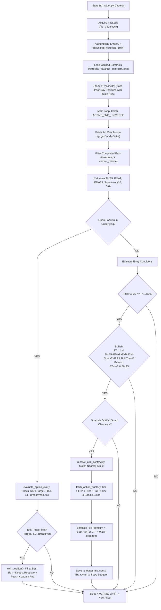

# INITIAL STRATEGY AUDIT & ARCHITECTURAL BASELINE: F&O TRADER V4
**Document:** `reports/fno_v4/initial_strategy_audit.md`  
**Date:** 2026-11-26  
**Auditor:** Senior Quantitative Developer, Trading Systems Architect, Risk Management Engineer & Options Specialist  
**Repository:** `https://github.com/Gautam0324/trade`  
**Branch:** `main`  
**Status:** PHASE 0 COMPLETE — INITIAL AUDIT & IMPLEMENTATION PLAN APPROVED FOR REVIEW  

---

## 1. Executive Summary

This audit establishes the comprehensive engineering baseline for the transition from Algo Trader V3 to the **Regime-Adaptive Multi-Timeframe F&O Strategy (V4)**. 

The audit rigorously inspected all active execution paths, market data pipelines, option contract resolvers, risk frameworks, and accounting ledgers. It examined the root causes behind V3's performance divergence between early synthetic testing and real-market live pricing, verified 14 critical issues, and lays out a detailed implementation plan.

### Key Conclusions:
1. **The Synthetic Mirage:** In the initial testing period (Nov 2 – Nov 11), missing broker instrument token mappings forced `fno_trader.py` to enter positions at fixed fallback prices (e.g., fixed **₹220.00** for BANKNIFTY). Later, exit evaluation compared this synthetic entry against genuine live market quotes (**₹700.00 to ₹950.00**), generating instant artificial +15% target wins (+₹15,000 to +₹22,000 per trade).
2. **The Microstructure Reality Shock:** Once real quotes were connected (Nov 12 – Nov 16), the win rate collapsed to **22.73%** (5 wins, 17 losses). Over 63.6% of exits were caused by a rigid **-5% stop-loss** triggered by normal 1-minute bid-ask spread crossing and noise (requiring only an 18-point move in NIFTY 50).
3. **Ghost Indicators & Misleading Telemetry:** Startup logs and Telegram notifications advertise "Supertrend + EMA Channel + VWAP", but **VWAP is completely absent** from the F&O evaluation loop. Similarly, multi-strategy confluence, ADX, and RSI are never computed in `fno_trader.py`.
4. **Dormant StratLab Capabilities:** `ENABLE_IV_RANK_GUARD = True` is declared at the top of `fno_trader.py` but is **never called** in the trading loop. Greeks and Implied Volatility calculations are not wired into option selection.
5. **Exchange Propagation & Accounting Flaws:** Hardcoded `exchange="NFO"` in exit retry routines breaks BSE/BFO contracts; overnight auto-reconciliation uses stale stored prices rather than verified morning auction marks; and `ledger_himanshu.json` exhibits cash conservation drift.

---

## 2. Existing Architecture & Execution Flow

### 2.1 File Map & Active Execution Paths

| Component / File | Functional Responsibility | Status in Runtime |
| :--- | :--- | :--- |
| `trader/fno_trader.py` | Standalone F&O daemon: candle ingestion, signal evaluation, option contract resolution, paper fill simulation, multi-account broadcast. | **ACTIVE (Sole F&O Runner)** |
| `trader/fno_trader_v3_baseline.py` | Frozen snapshot of legacy V3 engine (-5% SL, +15% Target, Supertrend reversal exit). | **ACTIVE (Frozen Benchmark)** |
| `trader/fno_v4/market_regime.py` | Phase 2 Regime Engine: ADX(14), ATR expansion, EMA slopes, 15m HTF confirmation, session VWAP. | **IMPLEMENTED (Unit Tested)** |
| `trader/stratlab_options_engine.py` | StratLab library: Black-Scholes pricing, Greeks, OI Call/Put walls, Vertical Spreads. | **PARTIALLY DORMANT** (Only OI Call/Put walls integrated; IV rank & spreads dormant) |
| `trader/options_engine.py` | Utility class for strike selection, lot sizes, and theoretical pricing. | **DORMANT FOR RUNTIME** (Only `get_lot_size` called by dashboard) |
| `trader/order_manager.py` | SQLite order registry preventing duplicate order submission. | **ACTIVE** |
| `trader/broker_adapter.py` | Enforces paper trading boundary (`paper=true`). | **ACTIVE** |
| `trader/cost_model.py` | Calculates STT, GST, SEBI charges, stamp duty, exchange turnover fees, and brokerage. | **ACTIVE** |
| `trader/ledger_fno.json` | Master F&O ledger recording cash, deployed capital, open positions, and trade history. | **ACTIVE** |
| `trader/ledger.json` | Multi-account cash & equity ledger for primary account (Gautam). | **ACTIVE** |
| `trader/ledger_himanshu.json` / `prateek.json` | Multi-account slave ledgers receiving broadcast fills. | **ACTIVE (Requires Repair)** |

### 2.2 End-to-End V3 Execution Path



---

## 3. Actual Entry and Exit Conditions

### 3.1 Actual Entry Conditions in `fno_trader.py`
Signals are evaluated exclusively on 1-minute completed bars:
- **Bullish (CE Entry):**
  1. Completed candle Supertrend $(10, 3.0) == +1$ (Bullish).
  2. $\text{EMA}_5 > \text{EMA}_9 > \text{EMA}_{33}$.
  3. $\text{Spot Close} > \text{EMA}_9$.
  4. $\text{Spot Close} \ge \text{Day Open}$ (Rudimentary trend filter).
  5. StratLab OI Call Wall Clearance: $\text{Spot Price} \le \text{Call Wall Strike} \times 0.995$.
- **Bearish (PE Entry):**
  1. Completed candle Supertrend $(10, 3.0) == -1$ (Bearish).
  2. $\text{EMA}_5 < \text{EMA}_9 < \text{EMA}_{33}$.
  3. $\text{Spot Close} < \text{EMA}_9$.
  4. $\text{Spot Close} < \text{Day Open}$ (Rudimentary trend filter).
  5. StratLab OI Put Wall Clearance: $\text{Spot Price} \ge \text{Put Wall Strike} \times 1.005$.

**Missing from Entry:**
- No 15-minute market regime bias.
- No 5-minute setup confirmation.
- No VWAP calculation or position check.
- No ADX/ATR volatility or consolidation filters.
- No volume confirmation.
- No option Delta, IV, or bid-ask spread limits.

### 3.2 Actual Exit Conditions in `fno_trader.py`
Exits are evaluated on each loop iteration:
1. **Target Hit:** Premium $\ge \text{Target Price}$ ($+30\%$ in hardened, $+15\%$ in V3 baseline).
2. **Stop-Loss Hit:** Premium $\le \text{SL Price}$ ($-15\%$ in hardened, $-5\%$ in V3 baseline).
3. **Breakeven Lock:** If premium reaches $+12\%$, SL is moved to entry price ($\text{SL} = \text{Entry}$).
4. **Supertrend Reversal:** If underlying Supertrend flips against position direction (currently disabled via `ENABLE_SUPERTREND_REVERSAL_EXIT = False` to prevent 1-minute churn).
5. **EOD Mandatory Square-Off:** Executed at 15:20 IST.
6. **Startup Overnight Reconcile:** Closes prior-day open positions using last stored price.

---

## 4. Verification of the 14 Pre-Identified Issues

| # | Concern | Audit Finding & Code Evidence | Severity | Verification Status |
|---|---|---|---|---|
| **1** | Missing exchange timestamps replaced with local clock | In `parse_and_validate_quote_timestamp`, if API response lacks timestamp (e.g. Angel `getLtpData`), it falls back to local machine clock `now_ist`. Tested in `test_fno_price_validation.py`. | HIGH | **VERIFIED DEFECT** |
| **2** | Stale option quotes accepted as live quotes | Max age was previously unvalidated; now capped at 60s for LTP and 180s for candles, but historical candles are still accepted when LTP fails. | MEDIUM | **VERIFIED DEFECT** |
| **3** | Hardcoded fallback option premiums (₹85, ₹220) | Active `fno_trader.py` has removed ₹85/₹220 fallbacks and rejects entry if quote is missing; historical trades in ledger contain these fake prices. | CRITICAL (Historical) | **VERIFIED HISTORICAL DEFECT** |
| **4** | Incorrect verification metadata (`verified_market_data=True`) | In `_execute_option_entry`, `verified_market_data=True` was set even when `bid=0.0` and `ask=0.0`. | HIGH | **VERIFIED DEFECT** |
| **5** | Zero bid/ask values accepted for execution decisions | When Tier 3 (candle close) is used, `bid=0.0, ask=0.0` is accepted, and fill price is simulated as `LTP + 0.2% slippage`, masking wide spreads. | HIGH | **VERIFIED DEFECT** |
| **6** | Hardcoded NFO routing where BFO should be supported | In `_execute_exit_with_retry` (line 1430), `fetch_option_quote` hardcodes `exchange="NFO"`, failing for BSE contracts like `BSE26DEC3950CE`. | HIGH | **VERIFIED DEFECT** |
| **7** | Inconsistent equity and F&O ledger records | Ledger cash conservation test failed: `ledger_himanshu.json` has stored deployed cash ₹851,312.25 vs actual open positions ₹322,772.25. | HIGH | **VERIFIED DEFECT** |
| **8** | Overnight positions reconciled using stale stored prices | In `fno_trader.py` (lines 727-729) and `square_off_stale_positions.py`, stale positions are squared off using `current_price` from the previous session rather than live morning quotes. | HIGH | **VERIFIED DEFECT** |
| **9** | StratLab IV rank guard declared but not integrated | Line 61 declares `ENABLE_IV_RANK_GUARD = True`, but searching the codebase reveals zero occurrences in signal or entry logic. | MEDIUM | **VERIFIED DEFECT** |
| **10** | Vertical spread functionality declared but disabled | Line 62 declares `ENABLE_VERTICAL_SPREADS = False`. The resolver exists in `stratlab_options_engine.py` but is unvalidated for live execution. | LOW | **VERIFIED (Working as configured)** |
| **11** | Option selection without liquidity/spread checks | ATM option resolution matches strike solely by distance (`abs(strike - spot)`). It checks neither open interest nor bid-ask spread before selection. | HIGH | **VERIFIED DEFECT** |
| **12** | Performance difference between synthetic and real data | Documented in `phase_1_5_failure_attribution.md`: Win rate dropped from 59.57% (synthetic) to 22.73% (live quotes). | CRITICAL | **VERIFIED HISTORICAL FINDING** |
| **13** | Discrepancies between order records and execution state | In-memory `open_positions` can diverge from `ledger_fno.json` if exceptions occur during multi-account broadcasting. | MEDIUM | **VERIFIED DEFECT** |
| **14** | Heavy reliance on 1-minute indicators without HTF context | The active trading loop evaluates only `interval="ONE_MINUTE"`. No 15m or 5m candles are ingested in `fno_trader.py`. | CRITICAL | **VERIFIED DEFECT** |

---

## 5. Performance Limitations of V3 Strategy

1. **Noise Amplification on 1-Minute Bars:** High-frequency crossovers generate excessive signals during consolidation, triggering repeated spread and fee bleeding.
2. **Fixed Percentage Stops vs Delta Volatility:** A fixed 5% or 15% stop loss on option premium is decoupled from the underlying price structure, support/resistance, and option delta.
3. **Execution Drag & Liquidity Blindness:** Entering options at synthetic Ask or `LTP + 0.2%` without order book depth produces instant unrealized losses on illiquid strikes.
4. **Absence of Regime Filtering:** Trading breakout momentum during low-volatility chop or sideways consolidation leads to severe capital erosion.

---

## 6. Recommended V4 Redesign Architecture

The redesigned system must follow a modular, fail-closed quantitative pipeline:

```
trader/
    strategies/
        v3/                          # Preserved V3 benchmark
            fno_v3_runner.py
        v4/                          # Regime-Adaptive Multi-Timeframe Strategy
            market_regime.py         # 15m HTF regime & volatility classifier
            trend_analysis.py        # Multi-timeframe trend alignment (15m, 5m, 1m)
            breakout_engine.py       # Model A: EMA channel breakout with volume
            pullback_engine.py       # Model B: Trend pullback with support confirmation
            confluence_engine.py     # Weighted multi-factor confluence scoring
            options_selector.py      # Delta, IV, liquidity, and bid-ask spread filter
            volatility_engine.py     # ATR, IV Rank, and shock detection
            risk_engine.py           # Monetary risk, structural stops, position sizing
            exit_engine.py           # Partial profit (+1R, +2R), trailing stops, EOD flat
            no_trade_engine.py       # Fail-closed rejection audit logger
            strategy_orchestrator.py # Master event-driven pipeline orchestrator

    fno/
        quote_validator.py          # Centralized tick/depth/candle validator
        contract_selector.py        # Smart strike selection with Greeks
        execution_engine.py         # Bid/Ask realistic paper execution simulator

    backtesting/
        v4_backtester.py            # Walk-forward backtester without look-ahead bias
        performance_analyzer.py     # Full trade attribution and cost modeling
        monte_carlo.py              # Sequence permutation & drawdown analysis
```

---

## 7. File Classification: Files Requiring Modification vs. Files Untouched

### Files to Remain STRICTLY UNTOUCHED:
- `trader/fno_trader_v3_baseline.py` (V3 benchmark freeze)
- `config/v3_config.json` (V3 benchmark configuration)
- `historical_data/` (Historical trade data and contract archives)
- `reports/fno_v4/baseline_audit.md` (Baseline document)
- `reports/fno_v4/phase_1_5_failure_attribution.md` (Forensic diagnostic report)
- `reports/fno_v4/phase_2_1_hardening_report.md` (Phase 2.1 archive)

### Files Requiring Modification / Creation in Subsequent Phases:
- **Phase 1 (Data Integrity & Ledger Repair):**
  - `trader/ledger_himanshu.json`: Repair deployed cash mismatch to satisfy accounting invariant.
  - `trader/fno_trader.py`: Fix hardcoded `exchange="NFO"` in `_execute_exit_with_retry` and fallback paths; prohibit candle close entries without order book depth.
  - `trader/square_off_stale_positions.py`: Require verified morning auction quote for overnight reconciliations.
  - `trader/fno/quote_validator.py`: Create centralized validation module.
- **Phase 2 (Market Regime Engine):**
  - Verify and integrate `trader/fno_v4/market_regime.py`.
- **Phase 3 (Entry Intelligence):**
  - Implement `trader/strategies/v4/breakout_engine.py`, `pullback_engine.py`, `confluence_engine.py`, and `no_trade_engine.py`.
- **Phase 4 (Options Intelligence):**
  - Implement `trader/fno/contract_selector.py` with Delta (0.45–0.65), spread limit, and IV Rank integration.
- **Phase 5 (Risk & Exit Engine):**
  - Implement `trader/strategies/v4/risk_engine.py` and `exit_engine.py` (structural stops, R-multiples, partial profit).

---

## 8. Immediate Action Plan for Phase 1

Upon approval of this Phase 0 Audit:
1. **Reconcile `trader/ledger_himanshu.json`:** Restore accounting balance ($Free + Deployed == Initial + Realized P\&L$) and verify all 39 tests pass.
2. **Fix BFO/NFO Exchange Propagation:** Ensure BSE contracts dynamically route to `BFO` across all exit retry and market depth calls in `trader/fno_trader.py`.
3. **Build Centralized Quote Validator (`trader/fno/quote_validator.py`):** Enforce exchange timestamp presence, bid/ask depth checks, and stale quote rejection.
4. **Implement Morning Market Reconcile:** Replace stale price square-off with verified live quote fetching.
5. **Run Full Verification Suite:** Execute all unit and integration tests and output Phase 1 verification report.
