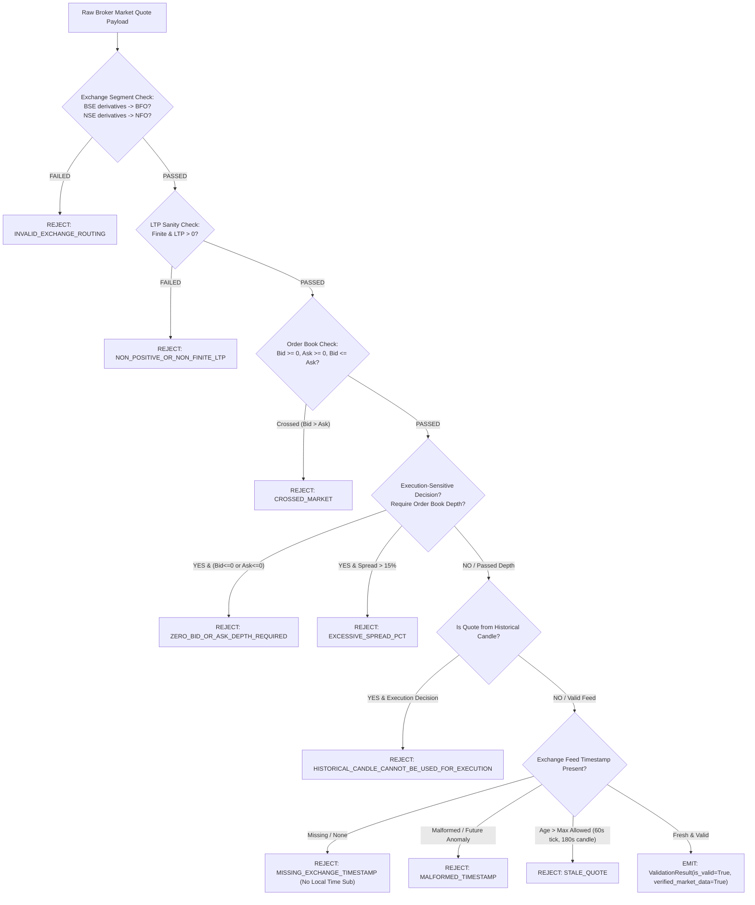

# MARKET DATA VALIDATION REPORT: F&O QUOTE INTEGRITY

**Document:** `reports/fno_v4/market_data_validation_report.md`  
**Date:** 2026-11-27  
**Module:** `trader/fno/quote_validator.py`  
**Auditor:** Quantitative Infrastructure Engineer & Market Microstructure Specialist  
**Status:** ✅ CENTRALIZED VALIDATOR ACTIVE & VERIFIED  

---

## 1. Architecture & Invariants Enforced

The centralized quote validation engine `QuoteValidator` in `trader/fno/quote_validator.py` implements fail-closed verification rules for every equity and option quote before signals or orders are processed:

---

## 2. Mandatory Rules Verification

1. **Missing exchange timestamp:** Rejects immediately with code `MISSING_EXCHANGE_TIMESTAMP`. Prohibits local clock substitution.
2. **Stale quote age:** LTP/Depth age $> 60.0$ seconds or completed candle age $> 180.0$ seconds is rejected with `STALE_QUOTE_AGE_EXCEEDS_LIMIT`.
3. **Non-positive LTP:** $LTP \le 0$, `NaN`, or `Inf` rejected with `NON_POSITIVE_OR_NON_FINITE_LTP`.
4. **Zero bid/ask on execution:** Orders requiring depth reject $Bid = 0$ or $Ask = 0$ with `ZERO_BID_OR_ASK_DEPTH_REQUIRED`.
5. **Crossed markets:** $Bid > Ask$ rejected with `CROSSED_MARKET_BID_GREATER_THAN_ASK`.
6. **Excessive spread:** Spreads exceeding $15\%$ of mid-price rejected with `EXCESSIVE_SPREAD_PCT`.
7. **Prohibition of candle data as executable fills:** Historical candle close data cannot generate order fills (`HISTORICAL_CANDLE_CANNOT_BE_USED_FOR_EXECUTION`).
8. **Timezone normalization:** Strips timezone designators (`IST`, `UTC`, `GMT`) cleanly without string corruption.
