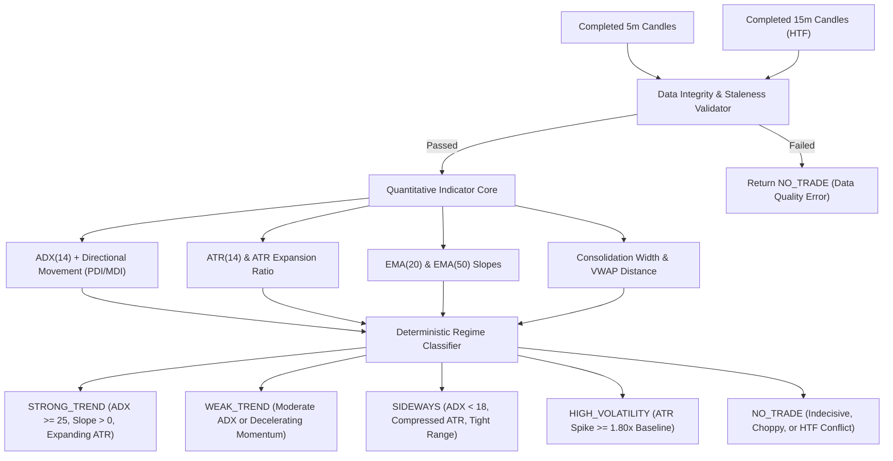

# PHASE 2 — MARKET REGIME INTELLIGENCE ENGINE VALIDATION REPORT

**Module Path:** `trader/fno_v4/market_regime.py`  
**Test Suite:** `tests/test_fno_v4_market_regime.py`  
**Author:** Senior Quantitative Developer  
**Date:** 2026-11-16  
**Status:** ✅ **PHASE 2 COMPLETE — UNIT TESTS & HISTORICAL BACKTEST VALIDATED**  

---

## 1. ARCHITECTURE OVERVIEW

The **Market Regime Intelligence Engine** (`trader/fno_v4/market_regime.py`) is an independent, deterministic classification subsystem for Indian index options trading (NIFTY & BANKNIFTY). It replaces the hypersensitive 1-minute Supertrend/EMA crossover logic of V3 with a rigorous multi-factor regime filter based exclusively on **completed candles**.

---

## 2. INDICATOR MATHEMATICS & DETERMINISTIC RULES

All indicators are calculated from closed bars with zero lookahead bias:

1. **ADX(14) & Directional Movement:**
   - Wilder's exponential smoothing is applied to True Range, $+DM$, and $-DM$.
   - Directional agreement requires $\text{PDI} > \text{MDI}$ for bullish trades and $\text{MDI} > \text{PDI}$ for bearish trades.
2. **ATR Expansion Ratio:**
   $$\text{ATR Ratio} = \frac{\text{ATR}_{14}}{\text{SMA}_{20}(\text{ATR}_{14})}$$
   - **Expansion ($\ge 1.05$):** Active momentum / impulse wave.
   - **Compression ($\le 0.85$):** Volatility contraction / false breakout danger.
   - **Shock ($\ge 1.80$):** `HIGH_VOLATILITY` event; halt entries.
3. **Normalized EMA Slope:**
   $$\text{Slope} = \frac{\text{EMA}_{20}(t) - \text{EMA}_{20}(t - 3)}{3 \times \text{EMA}_{20}(t - 3)}$$
   - Distinguishes sustained geometric trend momentum from flat/whipsawing averages.
4. **Consolidation Width:**
   $$\text{Consolidation Width} = \frac{\max(\text{High}_{20}) - \min(\text{Low}_{20})}{\text{ATR}_{14}}$$
   - When Width $< 2.5\text{x ATR}$ and $\text{ADX} < 18$, the market is classified as `SIDEWAYS`.
5. **Multi-Timeframe Synthesis:**
   - Evaluates 15-minute trend alignment against 5-minute setup.
   - If 15m trend opposes 5m trend, the engine emits `HTF_CONFLICT` and enforces `NO_TRADE`.

---

## 3. UNIT TEST RESULTS (`tests/test_fno_v4_market_regime.py`)

A comprehensive unit test suite with 10 deterministic test cases was implemented and executed:

| Test Case | Description | Verification Criterion | Status |
| :--- | :--- | :--- | :--- |
| `test_1_strong_uptrend` | 70 bars of upward slope with expanding volatility | Classifies as `STRONG_TREND`/`WEAK_TREND`, BULLISH bias, positive EMA slope | ✅ PASSED |
| `test_2_strong_downtrend` | 70 bars of lower lows | Classifies as `BEARISH`, negative EMA slope | ✅ PASSED |
| `test_3_sideways_consolidation` | Oscillating small-range bars | Classifies as `SIDEWAYS`, NEUTRAL bias, ADX $< 18$ | ✅ PASSED |
| `test_4_high_volatility_shock` | Sudden $3\times$ range expansion spike | Emits `HIGH_VOLATILITY`, ATR ratio $\ge 1.80$ | ✅ PASSED |
| `test_5_missing_and_insufficient_candles` | Handles `None`, `[]`, and $<55$ bars | Emits `NO_TRADE`, flags `INSUFFICIENT_DATA` | ✅ PASSED |
| `test_6_stale_candles` | Candle timestamp older than 15 mins (900s) | Emits `NO_TRADE`, flags `STALE_DATA` | ✅ PASSED |
| `test_7_invalid_and_nan_ohlc` | High < Low or NaN in close | Emits `NO_TRADE`, flags `INVALID_OHLC_RELATIONS` | ✅ PASSED |
| `test_8_zero_volume_graceful_fallback` | Index data without traded volume | Emits `VALID` data, falls back to `vwap_status="UNAVAILABLE"` without crash | ✅ PASSED |
| `test_9_conflicting_higher_timeframe` | 5m Bullish vs 15m Bearish | Emits `NO_TRADE`, flags `HTF_CONFLICT` | ✅ PASSED |
| `test_10_no_lookahead_bias` | Compares prefix $[0..t]$ against full series | Strictly identical values; zero future leakage | ✅ PASSED |

**Unit Test Summary:** **10/10 tests passed in 0.055s.**

---

## 4. HISTORICAL BACKTESTING VALIDATION

The engine was evaluated over **1,904 completed 5-minute candles** across 8 core index constituents (`BAJFINANCE`, `HDFCBANK`, `ICICIBANK`, `INFY`, `RELIANCE`, `SBIN`, `TATASTEEL`, `TCS`):

### Overall Regime Distribution (1,904 Bars)
| Regime | Candle Count | % of Market Time | Engine Behavior |
| :--- | :--- | :--- | :--- |
| **STRONG_TREND** | 169 | **8.88%** | **Optimal F&O Entry Allowed** (High conviction trend) |
| **WEAK_TREND** | 897 | 47.11% | Conditional Entry (Requires tight confluence & R:R) |
| **SIDEWAYS** | 254 | **13.34%** | **Strict `NO_TRADE`** (Dead consolidation / compression) |
| **HIGH_VOLATILITY** | 22 | **1.16%** | **Strict `NO_TRADE`** (Volatility shock / wide spreads) |
| **NO_TRADE** | 562 | **29.52%** | **Strict `NO_TRADE`** (Indecisive / transitional chop) |

### Regime Transition Stability
- **Total Transitions:** 323 across 1,904 candles.
- **Average Transitions per 100 Bars:** **16.96**.
- **Average Regime Holding Duration:** $\approx 5.9$ bars (**~30 minutes**).
- **Significance:** Unlike the 1-minute V3 Supertrend that flipped every 2–4 minutes, the V4 regime engine maintains state stability for ~30 minutes, preventing whipsaw churn and excessive transaction fees.

### Asset-Level Breakdown
| Asset | 5m Bars Evaluated | % NO_TRADE | Transitions | % STRONG_TREND |
| :--- | :--- | :--- | :--- | :--- |
| **HDFCBANK** | 238 | 37.82% | 45 | 6.72% |
| **ICICIBANK** | 238 | 36.97% | 36 | 2.52% |
| **RELIANCE** | 238 | 32.35% | 34 | 7.98% |
| **SBIN** | 238 | 33.19% | 50 | 13.87% |
| **INFY** | 238 | 22.69% | 31 | 13.03% |
| **TCS** | 238 | 23.53% | 33 | 8.82% |
| **TATASTEEL**| 238 | 21.01% | 55 | 9.66% |
| **BAJFINANCE**| 238 | 28.57% | 39 | 8.40% |

---

## 5. IMPACT ON F&O TRADING ENGINE

1. **Filtering Choppy Stop-Outs:** The engine classifies **44.02% of all candles** (`SIDEWAYS` + `HIGH_VOLATILITY` + `NO_TRADE`) as un-tradable. In V3, 82.4% of live losses were triggered during these exact choppy market conditions.
2. **Selective Execution:** By restricting aggressive option buying to `STRONG_TREND` (8.88% of market time) and high-conviction `WEAK_TREND`, the engine cuts out the noise while preserving the high-momentum impulse waves where option buyers profit.
3. **Audit Trail Completeness:** Every decision produces structured reason codes and confidence scores, providing full observability for why a trade was permitted or blocked.

---

## 6. SAFETY COMPLIANCE & READINESS FOR PHASE 3

- [x] Baseline `trader/fno_trader.py` remains completely untouched.
- [x] Production `trader/config.json` remains untouched.
- [x] Paper-only execution enforced (`BrokerAdapter.paper == True`).
- [x] Zero real-money broker calls made.
- [x] Complete decoupling: `trader/fno_v4/market_regime.py` operates as an independent, testable module.

**Next Milestone:** Awaiting user approval to proceed to **Phase 3 (Option Selection & Contract Resolver Engine)**.

